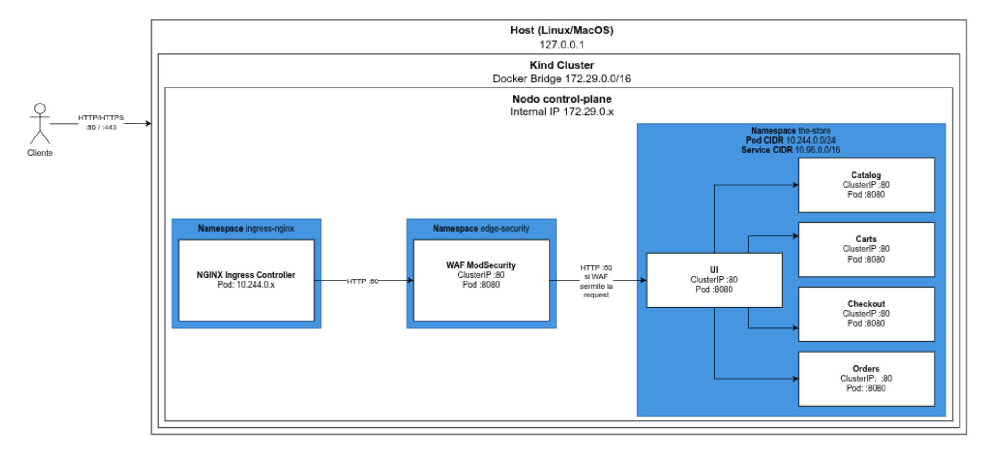

# TPE - Redes de Información

El presente trabajo implementa un Web Application Firewall (WAF) para proteger a The Store, una plataforma de e-commerce compuesta por microservicios y desplegada sobre un clúster de Kubernetes, desarrollado en el marco de la materia Redes de Información del Instituto Tecnológico de Buenos Aires. En su configuración original, el único punto de entrada al clúster es un Ingress Controller NGINX que no analiza ni filtra el tráfico de capa 7, por lo que cualquier request externo llega sin inspección a los servicios internos. Para resolverlo, se despliega un WAF basado en NGINX, ModSecurity v3 y el OWASP Core Rule Set (CRS) como componente independiente, en su propio namespace y ubicado entre el Ingress y la UI, sin modificar el código de los microservicios. El objetivo es demostrar, en una prueba de concepto, que el WAF bloquea un conjunto de vectores de ataque reales sobre la aplicación y deja registro auditable de cada transacción.

Las funcionalidades incluidas son las siguientes:

- <b>Control de Acceso por Path e IP</b>: Se bloquean con `403` los endpoints internos (`/utility`, `/proxy`, `/actuator`, `/info` y `/topology`) cuando la IP de origen no pertenece a la red de pods del clúster, mediante la regla propia `10100`.
- <b>Inspección de Query Parameters</b>: Se detectan payloads de SQL Injection y XSS en los parámetros de la URL con las familias 942xxx y 941xxx del CRS y el sistema de anomaly scoring.
- <b>Inspección del Body</b>: Se aplican las mismas reglas del CRS sobre el cuerpo de la request, tanto en formularios `urlencoded` como en JSON, una vez parseado en `ARGS_POST`.
- <b>Inspección de Headers y Cookies</b>: Se bloquean los User-Agent de scanners conocidos (familia 913xxx del CRS), las cookies `SESSIONID` que no respetan el formato UUID v4, las cookies `SESSIONID` duplicadas y el header `X-Forwarded-Prefix`.
- <b>Validación de Estructura de la Request</b>: Se rechaza con `400` el JSON mal formado y con `413` el body que supera los 128 KB.
- <b>Modos del Motor</b>: Se puede alternar el motor de ModSecurity entre `On`, `DetectionOnly` y `Off` con un único comando, lo que permite comparar el comportamiento con y sin WAF.
- <b>Auditoría Estructurada</b>: Cada transacción genera un audit log en JSON con la IP real del cliente, el request, el código de respuesta y las reglas disparadas, junto con un visor que lo muestra en formato legible.
- <b>Suite de Tests y Scripts de Demostración</b>: Se incluyen una suite de tests automática, un script de ataque por cada caso del POC y guiones para la demostración en vivo.

<details>
  <summary>Contenidos</summary>
  <ol>
    <li><a href="#arquitectura">Arquitectura</a></li>
    <li><a href="#implementación">Implementación</a></li>
    <li><a href="#instalación">Instalación</a></li>
    <li><a href="#instrucciones">Instrucciones</a></li>
    <li><a href="#manual-de-usuario">Manual de Usuario</a></li>
    <li><a href="#estructura">Estructura</a></li>
    <li><a href="#resolución-de-problemas">Resolución de Problemas</a></li>
    <li><a href="#aclaraciones">Aclaraciones</a></li>
    <li><a href="#integrantes">Integrantes</a></li>
  </ol>
</details>

## Arquitectura

La solución se despliega sobre un clúster local de [kind](https://kind.sigs.k8s.io/) (Kubernetes en Docker) de un único nodo. El tráfico externo ingresa por los puertos `80` y `443` del host, que kind mapea al nodo control-plane, y lo recibe el Ingress Controller NGINX. El único Ingress definido en el clúster apunta al Service del WAF, que inspecciona cada request y reenvía las legítimas al Service de la UI. A partir de ahí, la UI se comunica con el resto de los microservicios por la red interna del clúster.



*Figura 1. Diagrama de Arquitectura*

El flujo de una request queda definido de la siguiente manera:

```
cliente → Ingress NGINX → WAF (ModSecurity + CRS) → UI → microservicios
```

Los microservicios de The Store, que no se modifican salvo por el endpoint vulnerable agregado para el POC (ver [Aclaraciones](#aclaraciones)), son los siguientes:

| **Servicio** | **Tecnología** | **Descripción** |
|---|---|---|
| [UI](./src/ui/) | Java (Spring Boot) | Interfaz web de la tienda y único backend al que reenvía el WAF. |
| [Catalog](./src/catalog/) | Go | API del catálogo de productos, con búsqueda y filtrado por tags. |
| [Cart](./src/cart/) | Java (Spring Boot) | Gestión del carrito de compras (Service `carts`). |
| [Checkout](./src/checkout/) | Node.js (NestJS) | Orquestación del checkout y del pago. |
| [Orders](./src/orders/) | Java (Spring Boot) | Procesamiento y consulta de órdenes. |

<p align="right">(<a href="#tpe---redes-de-información">Volver</a>)</p>

## Implementación

A continuación se detalla cómo está construido el WAF y cómo se integra al clúster de The Store. Todos los manifiestos están en la carpeta `waf/` y se aplican juntos con Kustomize.

### Componente WAF

El WAF corre como un `Deployment` de una réplica en el namespace `edge-security`, usando la imagen oficial `owasp/modsecurity-crs:4.30.0-nginx-202610180210`, que trae NGINX, ModSecurity v3 y el CRS completo. La imagen se configura por variables de entorno en `waf/deployment.yaml`:

| **Variable** | **Valor** | **Función** |
|---|---|---|
| `BACKEND` | `http://ui.the-store.svc.cluster.local` | Service al que se reenvían las requests permitidas. |
| `MODSEC_RULE_ENGINE` | `On` | Modo del motor. Arranca bloqueando y se cambia con `scripts/waf.sh` (ver [Manual de Usuario](#manual-de-usuario)). |
| `MODSEC_REQ_BODY_NOFILES_LIMIT` | `131072` | Tamaño máximo del body sin archivos (128 KB). |
| `MODSEC_REQ_BODY_LIMIT_ACTION` | `Reject` | Rechaza los bodies que superan el límite. |
| `MODSEC_AUDIT_ENGINE` | `On` | Registra todas las transacciones, no solo las sospechosas. |
| `MODSEC_AUDIT_LOG_FORMAT` | `JSON` | Formato estructurado del audit log. |
| `MODSEC_AUDIT_LOG` | `/dev/stdout` | El audit log sale por la salida estándar del contenedor. |
| `SET_REAL_IP_FROM` / `REAL_IP_HEADER` | `10.244.0.0/16` / `X-Real-IP` | Confía en el header `X-Real-IP` solo si la conexión viene de la red de pods (donde vive el Ingress). |

El `Deployment` además define un `readinessProbe` sobre el puerto `8080`, de modo que un pod con una configuración inválida nunca recibe tráfico, y un `preStop` de 8 segundos para que el reemplazo de pods no corte requests en curso.

### Punto de Entrada Único

El Ingress original de la UI se eliminó de `dist/kubernetes.yaml`, y en su lugar se define `waf/ingress.yaml`, que envía todo el tráfico (`/`, sin filtro por `Host`) al Service `waf` en el puerto `80`. Este Service a su vez apunta al puerto `8080` del pod. De esta forma, ningún request externo puede llegar a la UI sin pasar antes por el WAF.

Para que las reglas basadas en IP funcionen, el WAF tiene que ver la IP real del cliente y no la del pod del Ingress. Esto se resuelve con `waf/nginx/realip.conf`, que se monta en `/etc/nginx/conf.d/` y reemplaza `REMOTE_ADDR` por el valor de `X-Real-IP`:

```nginx
set_real_ip_from 10.244.0.0/16;
real_ip_header X-Real-IP;
real_ip_recursive on;
```

### Carga de Reglas Propias

Las reglas propias viven en `waf/modsec/custom-rules.conf` y usan el rango de IDs `10000-19999`. `waf/kustomization.yaml` las empaqueta en un ConfigMap (`waf-modsec-rules`) con un `configMapGenerator`, y el `Deployment` las monta como `/etc/modsecurity.d/owasp-crs/rules/zzz-custom-rules.conf`. Como la imagen incluye automáticamente todos los `.conf` de esa carpeta, no hace falta modificar la configuración base de ModSecurity.

Kustomize agrega un hash del contenido al nombre del ConfigMap, por lo que cualquier cambio en las reglas cambia el nombre referenciado por el `Deployment` y Kubernetes reinicia el pod automáticamente al aplicar.

### Protecciones del POC

Cada caso de uso definido en la pre-entrega se resuelve con reglas del CRS, con reglas propias o con ambas:

| **Caso** | **Qué protege** | **Reglas** | **Respuesta** |
|---|---|---|---|
| 3.1 | Endpoints internos `/utility`, `/proxy`, `/actuator`, `/info` y `/topology` | Propia `10100` (path + IP fuera de `10.244.0.0/16` y `127.0.0.1`) | `403` |
| 3.2 | SQLi y XSS en query params (por ejemplo `GET /catalog?tag=...`) | CRS 942xxx (SQLi), 941xxx (XSS) y 949110 (umbral de anomalía) | `403` |
| 3.3 | SQLi y XSS en el body (`POST /checkout` urlencoded y `POST /catalog/products` JSON) | CRS 942xxx y 941xxx sobre `ARGS_POST` | `403` |
| 3.4 | Scanners, cookie `SESSIONID` manipulada y header `X-Forwarded-Prefix` | CRS 913xxx y propias `10300` (formato UUID v4), `10301` (cookie duplicada) y `10302` (header presente) | `403` |
| 3.5 | JSON mal formado y bodies demasiado grandes | Propias `10400` (`413`) y `10401` (`400`), que reemplazan a la regla base `200002` | `400` / `413` |

> **Nota**: La regla base `200002` convierte cualquier error de parseo del body en un `400`. Para distinguir el body demasiado grande (`413`) del JSON mal formado (`400`), se elimina con `SecRuleRemoveById 200002` y se parte en las reglas `10400` y `10401` según el mensaje de `REQBODY_ERROR_MSG`.

<p align="right">(<a href="#tpe---redes-de-información">Volver</a>)</p>

## Instalación

Clonar el repositorio:

- HTTPS:
  ```sh
  git clone https://github.com/ipedemonteb/redes-tpe.git
  ```
- SSH:
  ```sh
  git clone git@github.com:ipedemonteb/redes-tpe.git
  ```

Verificar que las herramientas necesarias estén instaladas y que Docker esté corriendo:

```sh
docker info >/dev/null && kind version && kubectl version --client && jq --version
```

> **Requisitos**: Docker corriendo con al menos 4 CPU y 8 GB de memoria disponibles para el clúster, [kind](https://kind.sigs.k8s.io/docs/user/quick-start/#installation), [kubectl](https://kubernetes.io/docs/tasks/tools/), `jq` (para el visor de logs), `curl` y `python3` (para los scripts de prueba). Los puertos `80` y `443` del host tienen que estar libres.

Una vez clonado el repositorio, la puesta en marcha se divide en dos pasos.

1. Crear el clúster kind, instalar el Ingress Controller NGINX y desplegar los cinco microservicios de The Store:
   ```sh
   ./local.sh create-cluster --skip-tests
   ```
2. Desplegar el WAF (namespace `edge-security`, Deployment, Service, Ingress y ConfigMaps con las reglas). El motor de ModSecurity arranca en modo `On`, por lo que el WAF bloquea desde el primer momento:
   ```sh
   kubectl apply -k waf/
   ```

Para comprobar que todo quedó levantado:

```sh
kubectl get pods -n the-store      # los 5 servicios en Running
kubectl get pods -n edge-security  # el pod waf en Running
kubectl get ingress -A             # un único Ingress, el de edge-security
curl -s -o /dev/null -w "%{http_code}\n" http://localhost/   # 200
./scripts/waf.sh status            # MODSEC_RULE_ENGINE=On
```

La tienda queda disponible en http://localhost.

> **Nota**: `waf/deployment.yaml` es la fuente de verdad del modo del motor. Si se lo cambió a `off` o `detect` con `./scripts/waf.sh`, el próximo `kubectl apply -k waf/` lo vuelve a dejar en `On`.

<p align="right">(<a href="#tpe---redes-de-información">Volver</a>)</p>

## Instrucciones

Todos los comandos deben ejecutarse desde la raíz del repositorio, con el clúster y el WAF ya desplegados.

- Ver o cambiar el modo del motor del WAF:
  ```sh
  ./scripts/waf.sh status
  ./scripts/waf.sh mode on|detect|off
  ```
- Correr la suite de tests del WAF:
  ```sh
  ./scripts/test-waf.sh
  ```
- Ejecutar los ataques de un caso del POC, o de todos en orden:
  ```sh
  ./scripts/attacks/3.1-paths-ip.sh
  ./scripts/attacks/run-all.sh
  ```
- Correr el guion de la demostración en vivo:
  ```sh
  ./scripts/demo.sh
  ```
- Ver el audit log del WAF en formato legible:
  ```sh
  ./scripts/waf-logs.sh -n 20
  ```
- Aplicar cambios en las reglas o en los manifiestos del WAF:
  ```sh
  kubectl apply -k waf/
  ```
- Eliminar el clúster completo:
  ```sh
  ./local.sh delete-cluster
  ```

<p align="right">(<a href="#tpe---redes-de-información">Volver</a>)</p>

## Manual de Usuario

A continuación se detallan los comandos y parámetros de cada script del proyecto. Todos los scripts que envían requests usan `http://localhost` como destino, que se puede cambiar con la variable de entorno `BASE_URL` (por ejemplo `BASE_URL=http://192.168.0.10 ./scripts/test-waf.sh`).

### Gestión del Clúster

El script `local.sh` viene con The Store y administra el clúster kind y los microservicios.

```sh
./local.sh <comando> [opciones]
```

| **Comando** | **Descripción** |
|---|---|
| `create-cluster` | Crea el clúster, instala ingress-nginx y despliega los servicios. |
| `rebuild-cluster` | Elimina el clúster y lo vuelve a crear. |
| `delete-cluster` | Elimina el clúster. |
| `status` | Muestra el estado del clúster. |
| `reload-images` | Construye las imágenes de Docker y las carga en kind. |
| `e2e-test` | Corre los tests end-to-end (Cypress) contra `http://localhost`. |
| `load-test` | Corre el generador de carga durante 10 minutos. |

| **Opción** | **Descripción** |
|---|---|
| `-c, --cluster <NOMBRE>` | Nombre del clúster (`the-store` por defecto). |
| `-n, --namespace <NOMBRE>` | Namespace de los servicios (`the-store` por defecto). |
| `--skip-tests` | No corre los tests e2e al crear o reconstruir el clúster. |
| `--skip-status` | No muestra el estado al crear o reconstruir el clúster. |

> **Nota**: El WAF no está integrado a `local.sh`. Después de un `create-cluster` o un `rebuild-cluster` hay que repetir el paso 2 de [Instalación](#instalación).

<p align="right">(<a href="#tpe---redes-de-información">Volver</a>)</p>

### Modo del WAF

```sh
./scripts/waf.sh mode <on|detect|off>
./scripts/waf.sh status
```

Parámetros:
- `mode on`: El motor inspecciona y bloquea (`MODSEC_RULE_ENGINE=On`).
- `mode detect`: El motor inspecciona y registra en el audit log, pero no bloquea (`DetectionOnly`). Sirve para calibrar reglas sin afectar el tráfico.
- `mode off`: El motor no inspecciona nada. Equivale a no tener WAF y se usa para comparar.
- `status`: Muestra el valor actual de `MODSEC_RULE_ENGINE`.

Cambiar de modo reinicia el pod del WAF, lo que tarda entre 10 y 15 segundos. El script espera a que termine el rollout antes de devolver el control. Si el WAF ya está en el modo pedido, no hace nada.

<p align="right">(<a href="#tpe---redes-de-información">Volver</a>)</p>

### Suite de Tests

```sh
./scripts/test-waf.sh
```

- Ejecuta 22 casos: tráfico legítimo que tiene que devolver `200` y los ataques de los casos 3.1 a 3.5, que tienen que devolver `403`, `400` o `413`.
- Imprime ✅ o ❌ por cada caso y un resumen final.
- Si el motor no está en `On`, lo enciende para correr los tests y al terminar lo restaura al modo original.
- Sale con código distinto de `0` si algún caso falla, por lo que sirve para validar que el sistema levantado de cero funciona correctamente.

<p align="right">(<a href="#tpe---redes-de-información">Volver</a>)</p>

### Scripts de Ataque

```sh
./scripts/attacks/<caso>.sh
./scripts/attacks/run-all.sh
```

Cada script reproduce los requests de un caso de la pre-entrega e imprime el comando `curl`, el código HTTP y el comienzo del body de la respuesta. No consulta el modo del WAF: el mismo script sirve con el motor apagado o encendido, y después de cada request muestra una nota según la respuesta (la regla que lo bloqueó, o la vulnerabilidad que queda expuesta si pasó).

| **Script** | **Ataques** |
|---|---|
| `3.1-paths-ip.sh` | `/proxy/orders`, `/actuator/metrics`, `/proxy/carts/victima-123`, `/utility/health/down` y `/utility/panic`. |
| `3.2-query-params.sh` | SQLi y XSS en el parámetro `tag` de `/catalog`. |
| `3.3-body.sh` | XSS en el formulario de `/checkout` (urlencoded), SQLi y XSS en el JSON de `/catalog/products`. |
| `3.4-headers.sh` | User-Agent de sqlmap y cookie `SESSIONID` sin formato UUID. |
| `3.5-estructura.sh` | JSON mal formado y body JSON de aproximadamente 500 KB. |
| `run-all.sh` | Ejecuta los cinco scripts anteriores en orden. |

Parámetros:
- `BODY_PREVIEW` (opcional): Variable de entorno con la cantidad de caracteres del body que se muestran (`300` por defecto).

Para mostrar el efecto del WAF en cada caso, se ejecuta el mismo script con el motor apagado y encendido:

```sh
./scripts/waf.sh mode off
./scripts/attacks/3.2-query-params.sh   # el ataque llega al servicio
./scripts/waf.sh mode on
./scripts/attacks/3.2-query-params.sh   # el ataque se bloquea con 403
```

> **Importante**: Con el motor en `off`, `3.1-paths-ip.sh` llama a `/utility/panic`, que tira la UI de verdad, y espera a que Kubernetes la reinicie (alrededor de 25 segundos). Con el motor en `on`, el request se bloquea y el script termina en el acto.

<p align="right">(<a href="#tpe---redes-de-información">Volver</a>)</p>

### Guion de la Demostración

```sh
./scripts/demo.sh [--no-pause] [--section <caso>] [--sin-waf]
```

Recorre los casos 3.1 a 3.5 con el motor en `On`, mostrando para cada uno un request legítimo que pasa y los ataques que se bloquean, y cierra con el audit log. No es destructivo, ya que con el WAF encendido `/utility/panic` se bloquea.

Parámetros:
- `--no-pause` (opcional): Recorre todo sin pausas. Por defecto espera un Enter entre cada caso, para que el orador controle el ritmo.
- `--section <caso>` (opcional): Ejecuta un solo caso: `3.1`, `3.2`, `3.3`, `3.4`, `3.5` o `logs`.
- `--sin-waf` (opcional): Antes de cada caso, ejecuta el mismo ataque con el motor apagado.

Si el motor no está en `On` al empezar, el script ofrece encenderlo.

<p align="right">(<a href="#tpe---redes-de-información">Volver</a>)</p>

### Demostración de Logs

```sh
./scripts/demo-logs.sh
```

- Dispara un mix de tráfico legítimo (home y catálogo) y de ataques (SQLi y XSS en `?tag`, User-Agent de sqlmap y `/proxy/orders`).
- Muestra el código de cada request y después las últimas transacciones del audit log, para ver cómo quedó registrada cada una.
- Requiere el motor en `On`. Si no lo está, avisa y termina.

<p align="right">(<a href="#tpe---redes-de-información">Volver</a>)</p>

### Visor del Audit Log

```sh
./scripts/waf-logs.sh [-n <N>] [-f] [--blocked]
```

Lee el audit log JSON que el WAF emite por `stdout` y muestra una línea por transacción, con el formato `HORA  CLIENTE  MÉTODO /uri  CÓDIGO  [reglas]  mensaje`.

Parámetros:
- `-n, --tail <N>` (opcional): Muestra las últimas `N` transacciones y termina.
- `-f, --follow` (opcional): Sigue el log en vivo hasta `Ctrl-C`. Es el comportamiento por defecto.
- `--blocked` (opcional): Muestra solo las transacciones bloqueadas (código `400` o mayor).
- `-h, --help` (opcional): Muestra la ayuda.

Para consultar el log sin el visor, se puede filtrar directamente con `kubectl` y `jq`:

```sh
kubectl logs -n edge-security deploy/waf | grep '^{"transaction"' | tail -1 \
  | jq '.transaction | {client_ip, uri: .request.uri, code: .response.http_code, rules: [.messages[].details.ruleId]}'
```

> **Nota**: Cada cambio de modo reemplaza el pod del WAF y, con él, su log. Solo quedan las transacciones posteriores al último cambio.

<p align="right">(<a href="#tpe---redes-de-información">Volver</a>)</p>

### Modificación de Reglas

Para agregar o modificar una regla propia:

1. Editar `waf/modsec/custom-rules.conf`, usando un ID libre dentro del rango `10000-19999`.
2. Aplicar los cambios. Kustomize recalcula el hash del ConfigMap y el pod se reinicia solo, con el motor en `On`:
   ```sh
   kubectl apply -k waf/
   ```
3. Verificar que no se rompió nada:
   ```sh
   ./scripts/test-waf.sh
   ```

Si la regla tiene un error de sintaxis, el pod nuevo no pasa el `readinessProbe` y el pod anterior sigue atendiendo el tráfico, por lo que una configuración inválida nunca llega a recibir requests.

<p align="right">(<a href="#tpe---redes-de-información">Volver</a>)</p>

## Estructura

El proyecto se estructura de la siguiente manera. Lo agregado para el TPE está en `waf/`, `scripts/` y `docs/`, mientras que `src/`, `dist/` y `local.sh` corresponden a The Store.

```
.
├── local.sh                    # Gestión del clúster kind y de The Store
├── dist/
│   └── kubernetes.yaml         # Manifiestos de los microservicios (sin el Ingress original)
├── src/                        # Código fuente de los microservicios (ui, catalog, cart, checkout, orders)
├── waf/
│   ├── kustomization.yaml      # Arma todo con kubectl apply -k y genera los ConfigMaps
│   ├── namespace.yaml          # Namespace edge-security
│   ├── deployment.yaml         # Imagen owasp/modsecurity-crs y su configuración
│   ├── service.yaml            # ClusterIP 80 → 8080
│   ├── ingress.yaml            # Único punto de entrada al clúster → Service waf
│   ├── nginx/
│   │   └── realip.conf         # IP real del cliente a partir de X-Real-IP
│   └── modsec/
│       └── custom-rules.conf   # Reglas propias (10100, 10300-10302, 10400-10401)
├── scripts/
│   ├── waf.sh                  # Modo del motor y estado
│   ├── test-waf.sh             # Suite de tests
│   ├── demo.sh                 # Guion de la demostración
│   ├── demo-logs.sh            # Demostración del audit log
│   ├── waf-logs.sh             # Visor del audit log
│   └── attacks/                # Un script por caso del POC (3.1 a 3.5) y run-all.sh
└── docs/                       # Pre-entrega, explicaciones, análisis de endpoints y consigna
```

<p align="right">(<a href="#tpe---redes-de-información">Volver</a>)</p>

## Resolución de Problemas

| **Síntoma** | **Causa probable y solución** |
|---|---|
| `curl http://localhost/` devuelve `000` o no conecta | El clúster no está levantado o el Ingress no tomó el puerto `80`. Revisar con `kubectl get pods -A` y verificar que ningún otro clúster kind esté usando los puertos `80` y `443`. |
| Los ataques devuelven `200` en lugar de `403` | El motor quedó en `Off` o `DetectionOnly` después de un `./scripts/waf.sh mode off` o `detect`. Verificar con `./scripts/waf.sh status` y encenderlo con `./scripts/waf.sh mode on`. |
| El pod del WAF queda en `ContainerCreating` con `configmap not found` | Falta `namespace: edge-security` en el `configMapGenerator` de `waf/kustomization.yaml`. Volver a aplicar con `kubectl apply -k waf/`. |
| `502` justo después de cambiar de modo | El pod anterior se está reemplazando. `waf.sh` ya espera el rollout, así que alcanza con reintentar el request. |
| El audit log muestra `client_ip: 10.244.x.x` | El WAF está viendo la IP del Ingress. Revisar que `waf/nginx/realip.conf` esté montado y volver a aplicar. |
| `kind load docker-image` falla con `content digest ... not found` | Problema de kind con imágenes multi-arquitectura. Descargar la imagen desde el nodo: `docker exec the-store-control-plane ctr --namespace=k8s.io images pull docker.io/owasp/modsecurity-crs:<tag>`. |

Para pausar y reanudar el clúster sin eliminarlo:

```sh
docker stop the-store-control-plane    # se pierden los carritos y órdenes en memoria
docker start the-store-control-plane
```

<p align="right">(<a href="#tpe---redes-de-información">Volver</a>)</p>

## Aclaraciones

Algunas aclaraciones finales con respecto a las funcionalidades de este trabajo:

- <b>Alcance Perimetral</b>: El WAF protege el punto de entrada al clúster. El tráfico entre pods no lo atraviesa, por lo que un atacante que ya esté dentro del clúster no es inspeccionado.
- <b>IDOR</b>: La regla `10100` corta el acceso externo a `/proxy/**` y la regla `10300` impide fijar valores arbitrarios de `SESSIONID`, pero la aplicación sigue sin validar la titularidad de carritos y órdenes. El WAF funciona como un parche virtual que mitiga la exposición, no como una corrección de la vulnerabilidad.
- <b>Filtro por User-Agent</b>: La familia 913xxx frena el escaneo automatizado, pero un atacante puede evadirla simplemente cambiando el User-Agent.
- <b>Retención de Logs</b>: El audit log se emite en JSON por `stdout` y se consulta con `kubectl logs`, que es efímero. La centralización y retención de logs (por ejemplo con EFK o Loki) corresponde a otro módulo del TPE y queda fuera del alcance.
- <b>Integración con local.sh</b>: El WAF se despliega por separado con `kubectl apply -k waf/` y no forma parte del flujo de `local.sh`.
- <b>Endpoint Vulnerable a Propósito</b>: `POST /catalog/products` concatena el campo `name` en una consulta SQL y lo refleja sin escapar, para que el WAF tenga ataques reales de SQLi y XSS que bloquear en la demostración. El código está marcado con `VULNERABLE A PROPÓSITO (POC WAF)` en `src/catalog/controller/controller.go` y `src/catalog/repository/repository.go`, y no debe usarse fuera de este contexto.

<p align="right">(<a href="#tpe---redes-de-información">Volver</a>)</p>

## Integrantes

Martín Alejandro Barnatán (64463) - mbarnatan@itba.edu.ar

Juan Ignacio Cantarella (64509) - jcantarella@itba.edu.ar

Ignacio Pedemonte Berthoud (64908) - ipedemonteberthoud@itba.edu.ar

<p align="right">(<a href="#tpe---redes-de-información">Volver</a>)</p>
