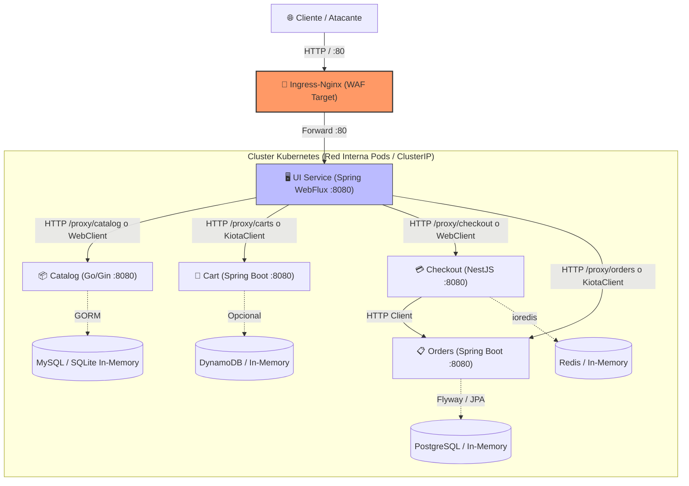

# Análisis Robusto de Endpoints, Servicios y Superficie de Ataque — The Store
**Proyecto: Redes de Información — TP Especial (ITBA 2026)**  
**Tema Asignado:** Tema 8 — Protección de Servicios con WAF  
**Fecha del Análisis:** Septiembre 2026  
**Documento Técnico de Referencia:** Inventario de APIs, Parámetros, Cabeceras y Análisis de Vulnerabilidades  

---

## 1. Resumen Ejecutivo y Arquitectura del Sistema

La plataforma **The Store** es una solución de comercio electrónico distribuida basada en una arquitectura de microservicios sobre **Kubernetes (Kind)**. El punto de entrada público a nivel de Capa 7 es el controlador de entrada **Ingress-Nginx**, el cual expone exclusivamente el servicio web **UI** en el puerto 80/443 (`http://localhost`).

A pesar de que los servicios de backend (*Catalog*, *Cart*, *Checkout*, *Orders*) se configuran como servicios internos (`ClusterIP`), la aplicación presenta severos vectores de exposición externa a través de componentes embebidos en el servicio **UI** (como el controlador de proxy inverso `ProxyController` y los endpoints de depuración `UtilityController`), además de carecer de autenticación y autorización en todos sus niveles (arquitectura *Zero-Auth*).



### Hallazgos de Seguridad Críticos a Nivel Arquitectónico:
1. **Exposición de Proxy Inverso Abierto (`ProxyController` en UI):** La UI expone rutas `/proxy/catalog/**`, `/proxy/carts/**`, `/proxy/checkout/**` y `/proxy/orders/**`. Cualquier atacante externo puede realizar peticiones `GET` directamente contra los servicios backend internos saltándose cualquier lógica de presentación.
2. **Filtración Masiva de Datos Sensibles (PII):** A través de `GET /proxy/orders`, un atacante sin autenticar puede extraer el historial completo de órdenes de compra del sistema, conteniendo nombres completos, direcciones de entrega, correos electrónicos y detalles de facturación.
3. **Controladores de Caos y DoS en Producción (`/chaos` y `/utility`):** Existen endpoints para inyectar latencia artificial, forzar códigos de error HTTP, desactivar *health checks* de Kubernetes y apagar de forma abrupta el proceso (`/utility/panic` ejecuta `System.exit(255)`).
4. **Ausencia Total de Control de Acceso (BOLA / IDOR):** No existen mecanismos de autenticación (JWT, OAuth2, Session segura). El identificador del carrito y checkout depende únicamente de una cookie no firmada (`SESSIONID`) o cabecera (`X-Session-ID`), permitiendo el secuestro de cualquier carrito ajeno mediante enumeración de IDs.
5. **Manipulación de Parámetros de Negocio (Price Tampering):** El servicio *Cart* permite agregar productos enviando el precio unitario (`unitPrice`) y cantidad en el cuerpo de la petición sin validarlo contra el catálogo central.

---

## 2. Matriz Consolidada de Endpoints del Repositorio

La siguiente tabla resume la totalidad de los endpoints expuestos en el código fuente de los 5 microservicios, clasificando su visibilidad, parámetros y nivel de riesgo para la auditoría de seguridad:

| Servicio | Método | Endpoint / URI | Visibilidad | Parámetros / Headers / Body | Nivel de Riesgo | Vector de Ataque / Vulnerabilidad Asociada |
| :--- | :--- | :--- | :--- | :--- | :--- | :--- |
| **UI** | `GET` | `/` y `/home` | Público (Ingress) | Cookie: `SESSIONID`<br>Header: `X-Session-ID` | ⚪ Bajo | Acceso a interfaz pública. |
| **UI** | `GET` | `/catalog` | Público (Ingress) | Query: `tag` (str), `page` (int), `size` (int)<br>Cookie: `SESSIONID`, `theme` | 🟡 Medio | Parámetros reflejados, posible DoS con `size` excesivo. |
| **UI** | `GET` | `/catalog/{id}` | Público (Ingress) | Path: `id` (str)<br>Cookie: `SESSIONID` | 🟡 Medio | Path traversal / inyección de identificador en llamadas backend. |
| **UI** | `GET` | `/cart` | Público (Ingress) | Cookie: `SESSIONID`<br>Header: `X-Session-ID` | 🔴 Alto | BOLA / IDOR: Suplantación de carrito forzando la cookie. |
| **UI** | `POST` | `/cart` | Público (Ingress) | Body Form: `productId` (str), `quantity` (int)<br>Cookie: `SESSIONID` | 🔴 Alto | Inyección de cantidades negativas o excesivas (Lógica de negocio). |
| **UI** | `POST` | `/cart/remove` | Público (Ingress) | Body Form: `productId` (str)<br>Cookie: `SESSIONID` | 🟡 Medio | Manipulación de sesión de carrito ajeno. |
| **UI** | `GET` | `/checkout` | Público (Ingress) | Cookie: `SESSIONID`<br>Header: `X-Session-ID` | 🔴 Alto | BOLA: Visualización de datos de despacho del cliente activo. |
| **UI** | `POST` | `/checkout` | Público (Ingress) | Body Form: `firstName`, `lastName`, `address1`, `address2`, `city`, `state`, `zipCode`, `email` | 🔴 Alto | XSS Almacenado / Inyecciones en campos de texto de despacho. |
| **UI** | `POST` | `/checkout/delivery`| Público (Ingress) | Body Form: `token` (str)<br>Cookie: `SESSIONID` | 🟡 Medio | Falsificación de token de tarifa de envío. |
| **UI** | `POST` | `/checkout/payment` | Público (Ingress) | Body Form: campos de pago simulados | 🔴 Alto | Confirmación de compra sin verificación crediticia/bancaria. |
| **UI** | `GET` | `/info` | Público (Ingress) | Query: `attr` (list[str]) | 🔴 Alto | **Information Disclosure:** Revela pod name, namespace, k8s node name. |
| **UI** | `GET` | `/topology` | Público (Ingress) | Ninguno | 🔴 Alto | **Reconocimiento:** Mapea dependencias internas y estado de backend. |
| **UI** | `POST` | `/chat/submit` | Público (Ingress) | Body JSON: `{"message": "string"}` | 🔴 Alto | Prompt Injection, SSE resource exhaustion / DoS. |
| **UI** | `GET` | `/proxy/catalog/**` | Público (Ingress) | Path: comodín forwarding | 🟡 Medio | SSRF / Bypass de interfaz hacia Catalog backend. |
| **UI** | `GET` | `/proxy/carts/**` | Público (Ingress) | Path: comodín forwarding | 🔴 Alto | BOLA: Lectura directa de carritos de cualquier usuario vía proxy. |
| **UI** | `GET` | `/proxy/checkout/**`| Público (Ingress) | Path: comodín forwarding | 🔴 Alto | BOLA: Lectura de tokens y estados de checkout de cualquier usuario. |
| **UI** | `GET` | `/proxy/orders/**` | Público (Ingress) | Path: comodín forwarding | 🚨 Crítico | **Exfiltración de PII:** `GET /proxy/orders` descarga todas las compras. |
| **UI** | `GET` | `/utility/panic` | Público (Ingress) | Ninguno | 🚨 Crítico | **Denial of Service (RCE-like):** Cierra el proceso JVM (`exit 255`). |
| **UI** | `GET` | `/utility/stress/{n}`| Público (Ingress) | Path: `iterations` (int) | 🚨 Crítico | **CPU Pegging DoS:** Ejecuta cálculo Monte Carlo intensivo. |
| **UI** | `POST` | `/utility/store` | Público (Ingress) | Body Raw: contenido a almacenar | 🔴 Alto | **Arbitrary File Write:** Escribe archivos en `/tmp/<hash>.json`. |
| **UI** | `GET` | `/utility/store/{h}` | Público (Ingress) | Path: `hash` (regex `[0-9]+`) | 🟡 Medio | **File Read:** Lectura de archivos cacheados en `/tmp`. |
| **UI** | `POST` | `/utility/echo` | Público (Ingress) | Body Raw: cualquier texto | 🔴 Alto | **Reflected XSS / Header injection:** Eco de cuerpo sin sanitizar. |
| **UI** | `GET` | `/utility/headers` | Público (Ingress) | Headers: cualquiera | 🔴 Alto | **Header Leak / Trace:** Refleja todas las cabeceras HTTP del request. |
| **UI** | `GET` | `/utility/status/{c}`| Público (Ingress) | Path: `code` (int) | 🟡 Medio | Forzado de estados HTTP arbitrarios. |
| **UI** | `POST` | `/utility/health/down`| Público (Ingress)| Ninguno | 🚨 Crítico | **Liveness DoS:** Marca la app DOWN; k8s reinicia el contenedor. |
| **UI** | `POST` | `/utility/health/up` | Público (Ingress)| Ninguno | 🟡 Medio | Manipulación del indicador de salud. |
| **UI** | `GET` | `/actuator/**` | Público (Ingress) | Path: `health`, `info`, `metrics`, `prometheus` | 🔴 Alto | **Information Disclosure:** Métricas internas de JVM, endpoints y memoria. |
| **Catalog** | `GET` | `/catalog/products` | ClusterIP / Proxy | Query: `tags` (str), `order` (str), `page` (int), `size` (int) | 🟡 Medio | Inyección de parámetros SQL (mitigada por GORM) / DoS paginación. |
| **Catalog** | `GET` | `/catalog/products/:id`| ClusterIP / Proxy| Path: `id` (str) | 🟡 Medio | Enumeración de productos, inyección de identificadores. |
| **Catalog** | `GET` | `/catalog/size` | ClusterIP / Proxy | Query: `tags` (str) | ⚪ Bajo | Enumeración de catálogo. |
| **Catalog** | `GET` | `/catalog/tags` | ClusterIP / Proxy | Ninguno | ⚪ Bajo | Listado de etiquetas disponibles. |
| **Catalog** | `GET` | `/health` | ClusterIP | Ninguno | ⚪ Bajo | Health check utilizado por Kubernetes. |
| **Catalog** | `GET` | `/topology` | ClusterIP | Ninguno | 🟡 Medio | Divulga persistencia (MySQL o in-memory) y endpoint de BD. |
| **Catalog** | `GET` | `/metrics` | ClusterIP | Ninguno | 🟡 Medio | Métricas de Prometheus de Go/Gin. |
| **Catalog** | `POST` | `/chaos/latency/:ms`| ClusterIP | Path: `ms` (int) | 🔴 Alto | **DoS:** Inyección de retrasos artificiales por solicitud. |
| **Catalog** | `DELETE`| `/chaos/latency` | ClusterIP | Ninguno | 🟡 Medio | Restablecimiento de latencia. |
| **Catalog** | `POST` | `/chaos/status/:code`| ClusterIP | Path: `code` (int) | 🔴 Alto | **DoS:** Forzar código de error en todas las rutas del catálogo. |
| **Catalog** | `DELETE`| `/chaos/status` | ClusterIP | Ninguno | 🟡 Medio | Restablecimiento de código de error. |
| **Catalog** | `POST` | `/chaos/health` | ClusterIP | Ninguno | 🔴 Alto | **Probe Poisoning:** Hace fallar el health check ante K8s. |
| **Catalog** | `DELETE`| `/chaos/health` | ClusterIP | Ninguno | 🟡 Medio | Restablecimiento de health check. |
| **Catalog** | `GET` | `/chaos/status` | ClusterIP | Ninguno | ⚪ Bajo | Consulta estado de caos. |
| **Cart** | `GET` | `/carts/{customerId}`| ClusterIP / Proxy| Path: `customerId` (str) | 🔴 Alto | **BOLA / IDOR:** Acceso al carrito de cualquier cliente. |
| **Cart** | `DELETE`| `/carts/{customerId}`| ClusterIP | Path: `customerId` (str) | 🔴 Alto | **BOLA:** Borrado malicioso del carrito de cualquier cliente. |
| **Cart** | `GET` | `/carts/{customerId}/merge` | ClusterIP / Proxy | Path: `customerId` (str)<br>Query: `sessionId` (str) | 🔴 Alto | Fusión no autorizada de carritos entre clientes distintos. |
| **Cart** | `GET` | `/carts/{customerId}/items` | ClusterIP / Proxy | Path: `customerId` (str) | 🔴 Alto | Lectura directa de items de un carrito ajeno. |
| **Cart** | `POST` | `/carts/{customerId}/items` | ClusterIP | Path: `customerId`<br>Body JSON: `itemId`, `quantity`, `unitPrice` | 🚨 Crítico | **Price Tampering:** El cliente define el precio unitario arbitrario. |
| **Cart** | `PATCH`| `/carts/{customerId}/items` | ClusterIP | Path: `customerId`<br>Body JSON: `itemId`, `quantity`, `unitPrice` | 🚨 Crítico | **Price Tampering:** Modificación de precio unitario en el carrito. |
| **Cart** | `GET` | `/carts/{customerId}/items/{itemId:.*}` | ClusterIP / Proxy | Path: `customerId` (str), `itemId` (regex `.*`) | 🔴 Alto | Path traversal o inyecciones vía expresión regular `.*`. |
| **Cart** | `DELETE`| `/carts/{customerId}/items/{itemId:.*}`| ClusterIP | Path: `customerId` (str), `itemId` (regex `.*`) | 🔴 Alto | Eliminación de items específicos de usuarios ajenos. |
| **Cart** | `GET` | `/topology` | ClusterIP | Ninguno | 🟡 Medio | Revela si utiliza DynamoDB o in-memory y endpoint AWS/local. |
| **Cart** | `POST` | `/chaos/latency/{ms}`| ClusterIP | Path: `ms` (int) | 🔴 Alto | Inyección de latencia en servicio Cart. |
| **Cart** | `DELETE`| `/chaos/latency` | ClusterIP | Ninguno | 🟡 Medio | Quitar latencia. |
| **Cart** | `POST` | `/chaos/status/{code}`| ClusterIP | Path: `code` (int) | 🔴 Alto | Forzar errores HTTP en Cart. |
| **Cart** | `DELETE`| `/chaos/status` | ClusterIP | Ninguno | 🟡 Medio | Quitar errores. |
| **Cart** | `POST` | `/chaos/health` | ClusterIP | Ninguno | 🔴 Alto | Deshabilitar salud de Cart (K8s restart DoS). |
| **Cart** | `DELETE`| `/chaos/health` | ClusterIP | Ninguno | 🟡 Medio | Habilitar salud de Cart. |
| **Cart** | `GET` | `/actuator/**` | ClusterIP | Path: `health`, `info`, `metrics`, `prometheus` | 🔴 Alto | Fuga de configuración de Spring Boot Actuator. |
| **Cart** | `GET` | `/v3/api-docs/**` | ClusterIP | Path OpenAPI | 🟡 Medio | Reconocimiento automático de esquemas de datos. |
| **Orders** | `GET` | `/orders` | ClusterIP / Proxy | Ninguno | 🚨 Crítico | **Mass PII Exposure:** Descarga sin autorización de todas las órdenes. |
| **Orders** | `POST` | `/orders` | ClusterIP | Body JSON: `Order` (`shippingAddress`, `items` con `unitCost`/`totalCost`) | 🚨 Crítico | **Tampering / Fraud:** Creación directa de órdenes con costos en 0. |
| **Orders** | `GET` | `/topology` | ClusterIP | Ninguno | 🟡 Medio | Divulga persistencia PostgreSQL y endpoints de RabbitMQ/SQS. |
| **Orders** | `POST` | `/chaos/latency/{ms}`| ClusterIP | Path: `ms` (int) | 🔴 Alto | Inyección de latencia en procesamiento de órdenes. |
| **Orders` | `DELETE`| `/chaos/latency` | ClusterIP | Ninguno | 🟡 Medio | Desactivar latencia en Orders. |
| **Orders** | `POST` | `/chaos/status/{code}`| ClusterIP | Path: `code` (int) | 🔴 Alto | Forzado de respuestas de error en órdenes. |
| **Orders** | `DELETE`| `/chaos/status` | ClusterIP | Ninguno | 🟡 Medio | Quitar forzado de error. |
| **Orders** | `POST` | `/chaos/health` | ClusterIP | Ninguno | 🔴 Alto | Caída de health checks de Orders. |
| **Orders** | `DELETE`| `/chaos/health` | ClusterIP | Ninguno | 🟡 Medio | Reactivación de salud de Orders. |
| **Orders** | `GET` | `/actuator/**` | ClusterIP | Path: Actuator endpoints | 🔴 Alto | Exposición de métricas y componentes del servicio de órdenes. |
| **Orders** | `GET` | `/v3/api-docs` | ClusterIP | Ninguno | 🟡 Medio | Exposición de especificación OpenAPI interna. |
| **Checkout**| `GET` | `/checkout/:customerId` | ClusterIP / Proxy | Path: `customerId` (str) | 🔴 Alto | **BOLA / IDOR:** Lectura de datos de compra, dirección y costos. |
| **Checkout**| `POST` | `/checkout/:customerId/update` | ClusterIP | Path: `customerId`<br>Body JSON: `items`, `shippingAddress`, `deliveryOptionToken` | 🚨 Crítico | **Price Tampering:** Modificación de precios y direcciones antes del pago. |
| **Checkout**| `POST` | `/checkout/:customerId/submit` | ClusterIP | Path: `customerId` (str) | 🔴 Alto | Envía orden a persistir en Orders; valida pago de forma ficticia. |
| **Checkout**| `GET` | `/health` | ClusterIP | Ninguno | ⚪ Bajo | Health check evaluado por Terminus. |
| **Checkout**| `GET` | `/topology` | ClusterIP | Ninguno | 🟡 Medio | Informa persistencia Redis y URLs de conexión. |
| **Checkout**| `GET` | `/api` y `/api-json` | ClusterIP | Ninguno | 🟡 Medio | Swagger UI interactivo accesible internamente. |
| **Checkout**| `POST` | `/chaos/latency/:ms`| ClusterIP | Path: `ms` (int) | 🔴 Alto | Retrasos artificiales en checkout. |
| **Checkout**| `DELETE`| `/chaos/latency` | ClusterIP | Ninguno | 🟡 Medio | Eliminar retrasos en checkout. |
| **Checkout**| `POST` | `/chaos/status/:code`| ClusterIP | Path: `code` (int) | 🔴 Alto | Simular fallos HTTP (ej. 500) en el proceso de checkout. |
| **Checkout**| `DELETE`| `/chaos/status` | ClusterIP | Ninguno | 🟡 Medio | Quitar simulación de fallos. |
| **Checkout**| `GET` | `/chaos/status` | ClusterIP | Ninguno | ⚪ Bajo | Consulta estado del controlador de caos en checkout. |
| **Checkout**| `POST` | `/chaos/health` | ClusterIP | Ninguno | 🔴 Alto | Falla el indicador Terminus y pod es marcado NotReady. |
| **Checkout**| `DELETE`| `/chaos/health` | ClusterIP | Ninguno | 🟡 Medio | Recuperación de salud en checkout. |

---

## 3. Análisis Exhaustivo por Servicio

### 3.1. Microservicio `ui` (Java Spring Boot 3 + WebFlux)
- **Ubicación:** `src/ui/`
- **Puerto interno:** 8080 (Mapeado en Kubernetes a `Service: ui:80`).
- **Exposición:** **Totalmente Pública**. Es el único microservicio alcanzable directamente a través del Ingress-Nginx (`host: localhost`).
- **Tecnología de Transporte:** Spring WebFlux (Reactor Netty) con integración de Spring Cloud Gateway `ProxyExchange`.

#### 3.1.1. Manejo Global de Sesión e Inyección de Cabeceras
El servicio cuenta con un filtro web reactivo (`SessionIDWebFilter.java`):
1. Inspecciona la cookie entrante `SESSIONID`. Si no existe, genera un UUID v4 aleatorio y lo envía en la cabecera `Set-Cookie: SESSIONID=<uuid>`.
2. **Vulnerabilidad Crítica:** Si el cliente envía una cookie preestablecida `SESSIONID: 1234-victima`, el filtro **la acepta sin validación criptográfica ni firma HMAC**.
3. El filtro muta la petición entrante agregando la cabecera interna:
   ```http
   X-Session-ID: <valor_de_cookie>
   ```
4. Esta cabecera es utilizada posteriormente para indexar el carrito y checkout del usuario en los servicios de backend. Al no requerir autenticación, **cualquier atacante puede secuestrar la sesión de compra de un usuario conociendo su identificador**.

#### 3.1.2. Rutas del Controlador Web (`HomeController`, `CatalogController`, `CartController`, `CheckoutController`)
* `GET /` y `GET /home`:
  - **Función:** Renderiza la vista inicial con productos destacados.
  - **Parámetros:** Ninguno directo. Consume cookie `SESSIONID` y cookie `theme`.
* `GET /catalog`:
  - **Función:** Catálogo general de productos.
  - **Parámetros Query:**
    - `tag` (string, opcional): Filtra productos por etiqueta.
    - `page` (int, opcional, default: `1`).
    - `size` (int, opcional, default: `6`).
  - **Riesgo:** Si no se limita el valor de `size`, un usuario malicioso puede solicitar `size=9999999` consumiendo memoria masiva en el servidor.
* `GET /catalog/{id}`:
  - **Función:** Detalle del producto individual y recomendaciones.
  - **Parámetros Path:** `id` (string, obligatorio).
* `GET /cart`:
  - **Función:** Despliega el contenido del carrito actual del usuario obtenido mediante `cartsService.getCart(sessionId)`.
* `POST /cart`:
  - **Consumes:** `application/x-www-form-urlencoded`.
  - **Parámetros Body:** `productId` (string), `quantity` (int).
  - **Riesgo:** No valida cantidades negativas (`quantity = -5`) a nivel de UI antes del reenvío al backend.
* `POST /cart/remove`:
  - **Consumes:** `application/x-www-form-urlencoded`.
  - **Parámetros Body:** `productId` (string).
* `GET /checkout`:
  - **Función:** Inicia el flujo de checkout y renderiza el formulario de dirección (`checkout-shipping.html`).
* `POST /checkout`:
  - **Consumes:** `application/x-www-form-urlencoded`.
  - **Parámetros Body:** `firstName`, `lastName`, `address1`, `address2`, `city`, `state`, `zipCode`, `email`.
  - **Riesgo:** **Cross-Site Scripting (XSS) y SQLi.** Los campos no son filtrados por WAF previo al procesamiento. Un payload `<script>alert(1)</script>` en `firstName` o `address1` se almacena en backend y se renderiza en la confirmación.
* `POST /checkout/delivery`:
  - **Parámetros Body:** `token` (string correspondiente a la opción de envío).
* `POST /checkout/payment`:
  - **Parámetros Body:** Parámetros de tarjeta de crédito (simulados). Completa el pedido invocando a `checkoutService.submit(sessionId)`.

#### 3.1.3. Asistente Virtual Inteligente (`ChatController.java`)
* `POST /chat/submit`:
  - **Condición:** Activo cuando `retail.ui.chat.enabled=true`.
  - **Consumes:** `application/json`.
  - **Produces:** `text/event-stream` (Server-Sent Events).
  - **Parámetros Body:**
    ```json
    {
      "message": "string"
    }
    ```
  - **Riesgo de Seguridad:** **Prompt Injection & Denial of Service.** La entrada del usuario se concatena directamente al prompt del modelo (`this.client.prompt(request.getMessage()).system(this.systemPrompt).stream()`). Permite manipular instrucciones del sistema y generar DoS por consumo de tokens o apertura masiva de conexiones SSE.

#### 3.1.4. Controlador de Proxy Inverso (`ProxyController.java`) — VULNERABILIDAD CRÍTICA
Implementado con Spring Cloud Gateway `ProxyExchange`:
```java
@GetMapping("/catalog/**")
public Mono<ResponseEntity<byte[]>> catalogProxy(ProxyExchange<byte[]> proxy) {
    return doProxy(proxy, "catalog", this.endpoints.getCatalog());
}
@GetMapping("/carts/**")
public Mono<ResponseEntity<byte[]>> cartsProxy(ProxyExchange<byte[]> proxy) {
    return doProxy(proxy, "carts", this.endpoints.getCarts());
}
@GetMapping("/checkout/**")
public Mono<ResponseEntity<byte[]>> checkoutProxy(ProxyExchange<byte[]> proxy) {
    return doProxy(proxy, "checkout", this.endpoints.getCheckout());
}
@GetMapping("/orders/**")
public Mono<ResponseEntity<byte[]>> ordersProxy(ProxyExchange<byte[]> proxy) {
    return doProxy(proxy, "orders", this.endpoints.getOrders());
}
```
* **Mecanismo:** Elimina el prefijo `/proxy` y retransmite la petición HTTP GET al endpoint interno del microservicio (`http://catalog`, `http://carts`, `http://checkout`, `http://orders`).
* **Vulnerabilidad:** **SSRF y Ruptura Total de Aislamiento de Red:**
  - `GET http://localhost/proxy/orders`: Retransmite a `http://orders/orders`, descargando **todas las órdenes de todos los clientes** en formato JSON sin autenticación.
  - `GET http://localhost/proxy/carts/<customerId>`: Permite inspeccionar el carrito de cualquier usuario.
  - `GET http://localhost/proxy/checkout/<customerId>`: Permite extraer direcciones y montos calculados.

#### 3.1.5. Endpoints de Utilidad y Diagnóstico (`UtilityController.java`) — EXTREMO PELIGRO
* `GET /utility/panic`:
  - **Código:**
    ```java
    SpringApplication.exit(context, () -> 1);
    System.exit(255);
    ```
  - **Impacto:** **Denegación de Servicio Inmediata (Remote Process Termination).** Cualquier visitante externo que envíe un `GET` a `/utility/panic` apaga el proceso Java de forma irreversible hasta que Kubernetes reinicie el pod.
* `GET /utility/stress/{iterations}`:
  - **Parámetro Path:** `iterations` (int).
  - **Impacto:** Ejecuta un bucle intensivo en CPU calculando Pi por Monte Carlo. Un atacante puede enviar `iterations=2000000000` saturando el CPU asignado al contenedor (128m requests / sin límite superior estricto), degradando el clúster.
* `POST /utility/store`:
  - **Consumes:** `text/plain` o `application/json`.
  - **Impacto:** **Escritura arbitraria en disco.** Escribe el cuerpo de la petición en `/tmp/<hash>.json`. Permite llenar el almacenamiento efímero del nodo o escribir datos maliciosos.
* `GET /utility/store/{hash}`:
  - **Parámetro Path:** `hash` (debe coincidir con `^[0-9]+$`).
  - **Impacto:** Lee y devuelve el archivo `/tmp/<hash>.json`.
* `POST /utility/echo`:
  - **Impacto:** **Reflected XSS:** Devuelve íntegro el payload recibido en el cuerpo.
* `GET /utility/headers`:
  - **Impacto:** **Information Disclosure:** Retorna un mapa JSON de todas las cabeceras HTTP que llegaron al backend (incluyendo cabeceras añadidas por Ingress como `X-Forwarded-For`, cookies, etc.).
* `POST /utility/health/down` y `POST /utility/health/up`:
  - **Impacto:** Marca el `ToggleHealthIndicator` como falso, haciendo que `/actuator/health/readiness` responda `503 Service Unavailable`, provocando que Kubernetes retire el pod del servicio.

#### 3.1.6. Información del Entorno y Topología
* `GET /info`:
  - Inyecta metadatos del clúster obtenidos desde variables de entorno del Pod:
    - `pod.name` (`METADATA_KUBERNETES_POD_NAME`)
    - `pod.namespace` (`METADATA_KUBERNETES_NAMESPACE`)
    - `node.name` (`METADATA_KUBERNETES_NODE_NAME`)
  - Revela la topología interna del clúster a atacantes en fase de reconocimiento.
* `GET /topology`:
  - Realiza consultas concurrentes a los microservicios de backend (`/topology`) y expone los proveedores de persistencia (MySQL, DynamoDB, PostgreSQL, Redis) y sus endpoints internos.

---

### 3.2. Microservicio `catalog` (Go + Gin Gonic)
- **Ubicación:** `src/catalog/`
- **Puerto interno:** 8080 (Mapeado a `Service: catalog:80`).
- **Persistencia:** SQLite en memoria o MySQL (mediante ORM GORM).
- **Controlador de Caos Embebido:** `middleware.ChaosController`.

#### 3.2.1. Endpoints de Negocio
* `GET /catalog/products`:
  - **Parámetros Query:**
    - `tags` (string, opcional): Etiquetas separadas por comas (ej. `apparel,tools`).
    - `order` (string, opcional): Criterio de orden (`price_asc`, `price_desc`). Por defecto ordena por nombre asc.
    - `page` (int, opcional, default: `1`).
    - `size` (int, opcional, default: `10`).
  - **Análisis de Inyección SQL:**
    - La consulta de etiquetas se realiza vía GORM: `.Where("tags.name IN ?", tags)`. Al usar sentencias parametrizadas, el riesgo clásico de SQLi por concatenación en `tags` está mitigado por el ORM.
    - El ordenamiento está protegido mediante un `switch-case` estricto en `repository.go`:
      ```go
      switch order {
      case "price_asc": query = query.Order("price asc")
      case "price_desc": query = query.Order("price desc")
      default: query = query.Order("products.name asc")
      }
      ```
    - **Vector WAF:** A pesar de la mitigación en código, los ataques SQLi inyectados en `?tags=' UNION SELECT...` o `?order=...` deben ser detectados e interceptados por las reglas CRS 942xxx en la capa perimetral.
* `GET /catalog/products/:id`:
  - **Parámetro Path:** `id` (string alfanumérico).
  - **Respuesta:** Objeto JSON con ID, descripción, precio y tags.
* `GET /catalog/size`:
  - **Parámetros Query:** `tags` (string, opcional).
  - **Respuesta:** `{"size": <conteo_entero>}`.
* `GET /catalog/tags`:
  - **Respuesta:** Arreglo JSON de tags con `name` y `displayName`.

#### 3.2.2. Endpoints de Diagnóstico y Caos
* `GET /health`:
  - Verifica si `chaosController.IsHealthy()` es true. Si fue deshabilitado, responde HTTP 503.
* `GET /topology`:
  - Retorna `{"databaseEndpoint": "...", "persistenceProvider": "in-memory|mysql"}`.
* `GET /metrics`:
  - Endpoint estándar del middleware `gin-prometheus` para recolección de telemetría.
* Rutas `/chaos/**` (`POST /chaos/latency/:ms`, `DELETE /chaos/latency`, `POST /chaos/status/:code`, `DELETE /chaos/status`, `POST /chaos/health`, `DELETE /chaos/health`, `GET /chaos/status`):
  - Permiten a cualquier actor de red manipular el comportamiento del servicio e interrumpir la disponibilidad de la tienda.

---

### 3.3. Microservicio `cart` (Java Spring Boot)
- **Ubicación:** `src/cart/`
- **Puerto interno:** 8080 (Mapeado a `Service: carts:80`).
- **Persistencia:** DynamoDB (AWS o Localstack) o `InMemoryCartService` (HashMap local).

#### 3.3.1. Endpoints de Negocio
* `GET /carts/{customerId}`:
  - **Parámetro Path:** `customerId` (string, típicamente el UUID de sesión).
  - **Respuesta:** Objeto JSON con `customerId` e `items[]`.
  - **Fallo de Seguridad:** **Broken Object Level Authorization (BOLA / IDOR):** No se verifica si el `customerId` solicitado pertenece a quien emite la petición.
* `DELETE /carts/{customerId}`:
  - **Parámetro Path:** `customerId` (string).
  - **Impacto:** Vaciado malicioso de carritos de clientes concurrentes.
* `GET /carts/{customerId}/merge?sessionId={sessionId}`:
  - **Parámetros:** `customerId` (path), `sessionId` (query).
  - **Impacto:** Permite forzar la unificación de carritos arbitrarios.
* `GET /carts/{customerId}/items`:
  - **Respuesta:** Lista de ítems en el carrito.
* `POST /carts/{customerId}/items`:
  - **Consumes:** `application/json`.
  - **Parámetros Body:**
    ```json
    {
      "itemId": "string",
      "quantity": 1,
      "unitPrice": 100
    }
    ```
  - **VULNERABILIDAD CRÍTICA (Price & Quantity Tampering):**
    El servicio `cart` **acepta ciegamente el campo `unitPrice`** provisto en el JSON:
    ```java
    CartItem item = new CartItem(itemId, quantity, unitPrice);
    this.get(customerId).getItems().add(item);
    ```
    No consulta a `catalog` para validar el precio real. Un atacante puede enviar `unitPrice: 0` o `unitPrice: -100` y comprar artículos gratis o alterar la contabilidad.
* `PATCH /carts/{customerId}/items`:
  - **Consumes:** `application/json`.
  - **Parámetros Body:** Mismo objeto `Item`. Permite sobreescribir el precio unitario y cantidad a voluntad.
* `GET /carts/{customerId}/items/{itemId:.*}` y `DELETE /carts/{customerId}/items/{itemId:.*}`:
  - **Parámetros Path:** `customerId`, `itemId`.
  - **Riesgo:** El uso de la expresión regular `{itemId:.*}` permite el paso de caracteres especiales, barras (`/`) y secuencias de escape no sanitizadas.

#### 3.3.2. Endpoints de Diagnóstico y Swagger
* `GET /actuator/health`, `/actuator/info`, `/actuator/metrics`, `/actuator/prometheus`.
* `GET /v3/api-docs` y `/v3/api-docs/carts`: Expone el esquema OpenAPI generado por SpringDoc.
* Controladores de caos idénticos a los de catálogo en el prefijo `/chaos/**`.

---

### 3.4. Microservicio `orders` (Java Spring Boot)
- **Ubicación:** `src/orders/`
- **Puerto interno:** 8080 (Mapeado a `Service: orders:80`).
- **Persistencia:** PostgreSQL o en memoria.
- **Mensajería:** RabbitMQ, AWS SQS o en memoria.

#### 3.4.1. Endpoints de Negocio
* `GET /orders`:
  - **Respuesta:** Lista completa de órdenes existentes en el sistema (`List<ExistingOrder>`).
  - **VULNERABILIDAD CRÍTICA (Total Data Leak / OWASP API3: Broken Object Property Level Authorization):**
    Devuelve cada orden almacenada con su ID, fecha de creación, dirección completa de envío (nombre, apellido, email, calle, ciudad, código postal) y todos los ítems adquiridos con sus costos.
    **Al estar expuesto a través de `GET /proxy/orders` en la UI, cualquier cliente externo puede descargar la base de datos de pedidos y clientes de la tienda.**
* `POST /orders`:
  - **Consumes:** `application/json`.
  - **Parámetros Body:**
    ```json
    {
      "shippingAddress": {
        "firstName": "string",
        "lastName": "string",
        "email": "string",
        "address1": "string",
        "address2": "string",
        "city": "string",
        "state": "string",
        "zipCode": "string"
      },
      "items": [
        {
          "productId": "string",
          "quantity": 1,
          "unitCost": 50,
          "totalCost": 50
        }
      ]
    }
    ```
  - **Riesgo:** Inyecciones de datos (SQLi/XSS) en `shippingAddress` y manipulación de montos financieros (`unitCost`, `totalCost`).

---

### 3.5. Microservicio `checkout` (Node.js + NestJS)
- **Ubicación:** `src/checkout/`
- **Puerto interno:** 8080 (Mapeado a `Service: checkout:80`).
- **Persistencia:** Redis o repositorio en memoria.

#### 3.5.1. Endpoints de Negocio
* `GET /checkout/:customerId`:
  - **Parámetro Path:** `customerId` (string).
  - **Respuesta:** Objeto `Checkout` con `items`, `shippingAddress`, `deliveryOptionToken`, `shippingRates`, `subtotal`, `tax`, `total`.
  - **Riesgo:** BOLA / IDOR. Permite ver el resumen de compra pendiente de cualquier cliente.
* `POST /checkout/:customerId/update`:
  - **Consumes:** `application/json`.
  - **Parámetros Body (`CheckoutRequest`):**
    ```json
    {
      "items": [
        {
          "id": "string",
          "name": "string",
          "quantity": 1,
          "price": 0
        }
      ],
      "shippingAddress": { ... },
      "deliveryOptionToken": "string"
    }
    ```
  - **Riesgo:** Permite recalcular totales forzando precios arbitrarios que luego se consolidarán al ordenar.
* `POST /checkout/:customerId/submit`:
  - **Parámetro Path:** `customerId` (string).
  - **Acción:** Envía la orden a `ordersService.create()` y retorna el `orderId` generado.

#### 3.5.2. Documentación y Diagnóstico
* `GET /api`: Interfaz web interactiva Swagger UI.
* `GET /api-json`: Especificación OpenAPI 3.0 en formato JSON.
* Rutas `/chaos/**`: Controlador idéntico para inyección de fallas.

---

## 4. Catálogo Exhaustivo de Vulnerabilidades y Mapeo Completo de Endpoints Afectados

A continuación se presenta el análisis detallado de cada familia de vulnerabilidad identificada en el repositorio. Para cada una de ellas se incluye su descripción técnica, el estándar OWASP / CWE correspondiente, la estrategia de mitigación en el WAF (ModSecurity / OWASP CRS) y **el listado exhaustivo de TODOS los endpoints de la arquitectura que la presentan**, detallando su método, parámetros involucrados y manifestación específica.

---

### 4.1. VULN-01: Broken Access Control & Broken Object Level Authorization (BOLA / IDOR)
* **Categoría OWASP:** A01:2021 — Broken Access Control
* **CWE Asociados:** CWE-639 (Authorization Bypass Through User-Controlled Key), CWE-284 (Improper Access Control).
* **Mecanismo e Impacto:** El sistema carece por completo de autenticación y autorización basada en tokens o identidades validadas. Los endpoints permiten consultar, modificar o eliminar recursos sensibles pertenecientes a otros usuarios simplemente alterando el identificador (`customerId`, `sessionId`, `itemId`) en la ruta, en los query params o en las cabeceras HTTP.
* **Mitigación en WAF:**
  - Bloqueo perimetral estricto de las rutas `/proxy/**` para evitar acceso directo a los servicios internos.
  - Reglas de correlación de sesión e inspección de cabeceras en Ingress (impedir cabeceras `X-Session-ID` arbitrarias forzadas desde el exterior).

#### Endpoints que poseen esta vulnerabilidad:

| Servicio | Método | Endpoint | Parámetros / Cabeceras Involucradas | Manifestación de la Vulnerabilidad |
| :--- | :--- | :--- | :--- | :--- |
| **UI** | `GET` | `/cart` | Cookie: `SESSIONID`, Header: `X-Session-ID` | Despliega el carrito del `SESSIONID` provisto. Un atacante puede suplantar la cookie y ver carritos ajenos. |
| **UI** | `POST` | `/cart` | Cookie: `SESSIONID`, Body: `productId`, `quantity` | Agrega productos al carrito de cualquier usuario forzando el valor de la cookie de sesión. |
| **UI** | `POST` | `/cart/remove` | Cookie: `SESSIONID`, Body: `productId` | Elimina productos del carrito de cualquier usuario manipulando la cookie de sesión. |
| **UI** | `GET` | `/checkout` | Cookie: `SESSIONID`, Header: `X-Session-ID` | Visualiza los datos de entrega y el estado del checkout asociados al `SESSIONID`. |
| **UI** | `POST` | `/checkout` | Cookie: `SESSIONID`, Body: datos de despacho | Asocia información de envío al checkout del `SESSIONID` sin autenticación previa. |
| **UI** | `POST` | `/checkout/delivery` | Cookie: `SESSIONID`, Body: `token` | Asigna el método de entrega al checkout correspondiente al `SESSIONID`. |
| **UI** | `POST` | `/checkout/payment` | Cookie: `SESSIONID`, Body: campos de pago | Confirma el pedido y vacía el checkout del `SESSIONID` provisto. |
| **UI** | `GET` | `/proxy/carts/**` | Path comodín (ej. `/proxy/carts/{customerId}`) | Reenvía la petición al backend de carritos, permitiendo saltarse la UI y consultar carritos ajenos. |
| **UI** | `GET` | `/proxy/checkout/**` | Path comodín (ej. `/proxy/checkout/{customerId}`) | Reenvía la petición al backend de checkout, permitiendo leer checkouts ajenos. |
| **UI** | `GET` | `/proxy/orders/**` | Path comodín (ej. `/proxy/orders`) | Reenvía la petición al backend de órdenes, permitiendo descargar todas las compras del sistema. |
| **Cart** | `GET` | `/carts/{customerId}` | Path: `customerId` | Retorna el contenido del carrito del cliente solicitado sin comprobar titularidad. |
| **Cart** | `DELETE` | `/carts/{customerId}` | Path: `customerId` | Borra/vacía el carrito del cliente especificado sin autorización. |
| **Cart** | `GET` | `/carts/{customerId}/merge` | Path: `customerId`, Query: `sessionId` | Fusiona forzosamente dos carritos distintos a petición del cliente. |
| **Cart** | `GET` | `/carts/{customerId}/items` | Path: `customerId` | Retorna la lista de ítems del carrito de cualquier usuario. |
| **Cart** | `POST` | `/carts/{customerId}/items` | Path: `customerId`, Body: `Item` | Inserta ítems en el carrito de cualquier cliente objetivo. |
| **Cart** | `PATCH` | `/carts/{customerId}/items` | Path: `customerId`, Body: `Item` | Modifica cantidades o precios en el carrito de cualquier cliente. |
| **Cart** | `GET` | `/carts/{customerId}/items/{itemId:.*}` | Path: `customerId`, `itemId` | Consulta un ítem específico dentro del carrito de cualquier cliente. |
| **Cart** | `DELETE` | `/carts/{customerId}/items/{itemId:.*}` | Path: `customerId`, `itemId` | Elimina un ítem específico dentro del carrito de cualquier cliente. |
| **Checkout** | `GET` | `/checkout/:customerId` | Path: `customerId` | Obtiene el estado íntegro de la orden en curso (artículos, direcciones, costos y tokens de pago). |
| **Checkout** | `POST` | `/checkout/:customerId/update` | Path: `customerId`, Body: `CheckoutRequest` | Modifica la dirección de entrega, tarifas y productos del checkout de cualquier cliente. |
| **Checkout** | `POST` | `/checkout/:customerId/submit` | Path: `customerId` | Dispara la confirmación y persistencia de la orden en nombre de cualquier cliente. |
| **Orders** | `GET` | `/orders` | Ninguno | Retorna el listado completo de todas las órdenes de todos los clientes sin control de acceso. |

---

### 4.2. VULN-02: Exposición Masiva de Datos Sensibles (PII Leak & Information Disclosure)
* **Categoría OWASP:** A05:2021 — Security Misconfiguration / A01:2021 — Broken Access Control
* **CWE Asociados:** CWE-200 (Exposure of Sensitive Information to an Unauthorized Actor), CWE-359 (Exposure of Private Personal Information).
* **Mecanismo e Impacto:** Endpoints que divulgan información personal identificable (PII) de los clientes (nombres, correos electrónicos, direcciones físicas de despacho) o metadatos críticos de infraestructura (topología del clúster Kubernetes, nombres de pods, nodos, endpoints de bases de datos internas y especificaciones OpenAPI).
* **Mitigación en WAF:**
  - Bloqueo en Ingress de patrones `/actuator/**`, `/topology`, `/info`, `/v3/api-docs/**` y `/api-json`.
  - Bloqueo total de la ruta `/proxy/orders`.
  - Inspección de respuestas HTTP para prevenir fugas de datos mediante reglas de salida (*Response Body Inspection* / Data Loss Prevention).

#### Endpoints que poseen esta vulnerabilidad:

| Servicio | Método | Endpoint | Parámetros Involucrados | Manifestación de la Vulnerabilidad |
| :--- | :--- | :--- | :--- | :--- |
| **UI** | `GET` | `/proxy/orders` | Path forwarding | **Fuga Crítica de PII:** Expone todas las compras, nombres, direcciones físicas y emails de clientes. |
| **Orders** | `GET` | `/orders` | Ninguno | Genera el JSON con el historial de compras y datos personales de todos los usuarios registrados. |
| **UI** | `GET` | `/info` | Query: `attr` (opcional) | Expone variables de entorno del pod: `pod.name`, `pod.namespace` y `node.name` del clúster Kubernetes. |
| **UI** | `GET` | `/topology` | Ninguno | Mapea la red interna revelando los endpoints de conexión y estado de todos los microservicios. |
| **UI** | `GET` | `/utility/headers` | Headers HTTP | Refleja todas las cabeceras HTTP que llegaron al pod, revelando cookies y cabeceras de proxy. |
| **UI** | `GET` | `/actuator/health` | Ninguno | Informa el estado de salud y detalles internos de componentes de Spring Boot. |
| **UI** | `GET` | `/actuator/info` | Ninguno | Revela información de compilación y versión de la aplicación. |
| **UI** | `GET` | `/actuator/metrics` | Ninguno | Expone métricas detalladas de memoria JVM, hilos de ejecución y recolección de basura. |
| **UI** | `GET` | `/actuator/prometheus` | Ninguno | Permite el raspado no autorizado de telemetría y contadores internos del sistema. |
| **Catalog** | `GET` | `/topology` | Ninguno | Informa si la base de datos es MySQL o SQLite y expone la URL interna de la BD. |
| **Catalog** | `GET` | `/metrics` | Ninguno | Expone métricas internas del framework Gin y Go runtime. |
| **Cart** | `GET` | `/topology` | Ninguno | Expone si se utiliza DynamoDB o memoria local, nombres de tablas y endpoints de AWS. |
| **Cart** | `GET` | `/actuator/**` | Path: `health`, `info`, `metrics`, `prometheus` | Revela telemetría interna y estado de ejecución del microservicio de carritos. |
| **Cart** | `GET` | `/v3/api-docs` y `/v3/api-docs/carts` | Ninguno | Expone la definición OpenAPI completa facilitando el reconocimiento automatizado de la API. |
| **Orders** | `GET` | `/topology` | Ninguno | Divulga persistencia PostgreSQL y configuración de brokers de mensajería (RabbitMQ/SQS). |
| **Orders** | `GET` | `/actuator/**` | Path: `health`, `info`, `metrics`, `prometheus` | Expone métricas internas de la JVM y estado del servicio de órdenes. |
| **Orders** | `GET` | `/v3/api-docs` | Ninguno | Expone la especificación OpenAPI de las entidades y esquemas de órdenes. |
| **Checkout** | `GET` | `/topology` | Ninguno | Informa si el backend usa Redis y publica la URI de conexión al servidor Redis. |
| **Checkout** | `GET` | `/api` | Ninguno | Expone la interfaz web interactiva Swagger UI con la documentación completa de checkout. |
| **Checkout** | `GET` | `/api-json` | Ninguno | Expone el esquema OpenAPI en formato JSON del servicio de checkout. |

---

### 4.3. VULN-03: Denegación de Servicio (DoS), Saturación de Recursos y Terminación de Procesos
* **Categoría OWASP:** A04:2021 — Insecure Design
* **CWE Asociados:** CWE-400 (Uncontrolled Resource Consumption), CWE-730 (Denial of Service), CWE-674 (Uncontrolled Recursion / Iteration).
* **Mecanismo e Impacto:** Endpoints que permiten a un atacante saturar la CPU, consumir memoria de forma desmedida, forzar errores HTTP generalizados, inyectar latencias artificiales o directamente provocar la muerte abrupta del proceso Java (`System.exit`), dejando el servicio inoperativo.
* **Mitigación en WAF:**
  - Bloqueo perimetral inmediato de rutas `/utility/panic`, `/utility/stress/**`, `/utility/health/**` y `/chaos/**`.
  - Rate limiting y límites de tamaño en query params (ej. restringir el valor de `size` en catálogo).
  - Reglas CRS 920xxx para validación de protocolos y límites de conexiones persistentes (SSE).

#### Endpoints que poseen esta vulnerabilidad:

| Servicio | Método | Endpoint | Parámetros Involucrados | Manifestación de la Vulnerabilidad |
| :--- | :--- | :--- | :--- | :--- |
| **UI** | `GET` | `/utility/panic` | Ninguno | **RCE-like DoS:** Ejecuta `System.exit(255)` provocando la muerte inmediata del proceso JVM. |
| **UI** | `GET` | `/utility/stress/{iterations}` | Path: `iterations` | **CPU Pegging:** Ejecuta un cálculo Monte Carlo por $N$ iteraciones; satura la CPU del contenedor al 100%. |
| **UI** | `POST` | `/utility/health/down` | Ninguno | **Liveness DoS:** Marca el indicador de salud en `DOWN`; Kubernetes retira el pod o lo reinicia. |
| **UI** | `GET` | `/catalog` | Query: `size` | Permite solicitar tamaños masivos de página (ej. `size=1000000`) consumiendo memoria de la JVM. |
| **UI** | `POST` | `/chat/submit` | Body JSON: `message` | Permite abrir múltiples streams SSE concurrentes provocando agotamiento de hilos y memoria. |
| **Catalog** | `POST` | `/chaos/latency/:ms` | Path: `ms` | Inyecta retardos artificiales en todas las peticiones que procese el catálogo. |
| **Catalog** | `POST` | `/chaos/status/:code` | Path: `code` | Fuerza que todas las rutas del catálogo respondan con el código de error indicado (ej. 500 o 503). |
| **Catalog** | `POST` | `/chaos/health` | Ninguno | Desactiva el health check interno haciendo que `/health` responda 503 y falle la sonda de K8s. |
| **Cart** | `POST` | `/chaos/latency/{ms}` | Path: `ms` | Inyecta latencia artificial en todas las llamadas entrantes al microservicio Cart. |
| **Cart** | `POST` | `/chaos/status/{code}` | Path: `code` | Fuerza respuestas de error HTTP en todas las operaciones del carrito. |
| **Cart** | `POST` | `/chaos/health` | Ninguno | Desactiva el indicador de salud provocando que las sondas de Kubernetes fallen. |
| **Orders** | `POST` | `/chaos/latency/{ms}` | Path: `ms` | Inyecta latencia en la persistencia y consulta de órdenes de compra. |
| **Orders** | `POST` | `/chaos/status/{code}` | Path: `code` | Simula fallos de disponibilidad en el procesamiento de pedidos. |
| **Orders** | `POST` | `/chaos/health` | Ninguno | Provoca fallos en las sondas de salud del microservicio Orders. |
| **Checkout** | `POST` | `/chaos/latency/:ms` | Path: `ms` | Agrega demoras forzadas en el flujo crítico de checkout provocando timeouts en clientes. |
| **Checkout** | `POST` | `/chaos/status/:code` | Path: `code` | Provoca respuestas con errores HTTP forzados en los endpoints de checkout. |
| **Checkout** | `POST` | `/chaos/health` | Ninguno | Hace fallar el indicador de Terminus haciendo que Kubernetes marque el pod como `NotReady`. |

---

### 4.4. VULN-04: Inyecciones en Capa de Aplicación (SQLi, XSS y LLM Prompt Injection)
* **Categoría OWASP:** A03:2021 — Injection
* **CWE Asociados:** CWE-89 (SQL Injection), CWE-79 (Cross-Site Scripting), CWE-77 (Command / Payload Injection).
* **Mecanismo e Impacto:** Procesamiento de datos suministrados por el usuario en formularios, parámetros de consulta o cuerpos JSON sin adecuada sanitización o validación tipológica, permitiendo alterar consultas SQL, ejecutar scripts JavaScript en el navegador de la víctima o alterar el comportamiento de modelos de lenguaje.
* **Mitigación en WAF:**
  - **CRS 942xxx (SQL Injection Protection):** Detección de palabras clave SQL (`UNION`, `SELECT`, `OR 1=1`, comentarios `--`).
  - **CRS 941xxx (Cross-Site Scripting Protection):** Coincidencia de firmas de etiquetas HTML (`<script>`, `<iframe>`), manipuladores de eventos (`onerror`, `onload`) y esquemas `javascript:`.
  - Inspección del cuerpo de peticiones JSON para palabras clave de evasión de prompts en `/chat/submit`.

#### Endpoints que poseen esta vulnerabilidad:

| Servicio | Método | Endpoint | Parámetros Involucrados | Tipo de Inyección y Manifestación |
| :--- | :--- | :--- | :--- | :--- |
| **UI** | `GET` | `/catalog` | Query: `tag` | **SQLi:** El parámetro `tag` se retransmite hacia el backend para filtrar en la cláusula SQL. |
| **UI** | `GET` | `/proxy/catalog/products` | Query: `tags` | **SQLi:** Pasa directamente al backend de catálogo y es evaluado en la base de datos. |
| **Catalog** | `GET` | `/catalog/products` | Query: `tags` | **SQLi:** Recibe lista de etiquetas evaluadas mediante GORM en la cláusula `tags.name IN ?`. |
| **Catalog** | `GET` | `/catalog/size` | Query: `tags` | **SQLi:** Recibe lista de etiquetas evaluadas en la consulta de conteo de productos. |
| **UI** | `POST` | `/checkout` | Body Form: `firstName`, `lastName`, `address1`, `address2`, `city`, `state`, `zipCode`, `email` | **Stored XSS:** Campos de texto no sanitizados que se almacenan y se reflejan en vistas de confirmación. |
| **UI** | `POST` | `/utility/echo` | Body Raw: cualquier texto | **Reflected XSS:** Devuelve el cuerpo exacto en la respuesta con cabeceras de texto plano/HTML. |
| **Checkout** | `POST` | `/checkout/:customerId/update` | Body JSON: campos de `shippingAddress` | **Stored XSS:** Recibe datos de dirección sin validación contra scripts maliciosos. |
| **Orders** | `POST` | `/orders` | Body JSON: campos de `shippingAddress` | **Stored XSS / Data Injection:** Persiste los datos de despacho recibidos sin filtrado previo. |
| **UI** | `POST` | `/chat/submit` | Body JSON: `message` | **Prompt Injection:** El mensaje se concatena directamente al prompt del sistema del asistente virtual. |

---

### 4.5. VULN-05: Manipulación de Integridad de Datos y Lógica de Negocio (Price & Quantity Tampering)
* **Categoría OWASP:** A08:2021 — Software and Data Integrity Failures
* **CWE Asociados:** CWE-472 (External Control of Assumed-Immutable Web Parameter), CWE-840 (Business Logic Errors).
* **Mecanismo e Impacto:** El sistema delega en el cliente la definición de atributos inmutables de negocio, tales como el precio unitario (`unitPrice` / `unitCost`) o permite enviar cantidades negativas (`quantity`), permitiendo a un atacante comprar artículos sin costo, manipular el subtotal facturado o desbalancear inventarios.
* **Mitigación en WAF:**
  - Validación de esquemas JSON en el cuerpo de las peticiones (*Request Body Schema Validation*).
  - Reglas personalizadas de inspección de contenido: rechazar cuerpos con campos `unitPrice: 0` o números negativos en `quantity`.

#### Endpoints que poseen esta vulnerabilidad:

| Servicio | Método | Endpoint | Parámetros Involucrados | Manifestación de la Vulnerabilidad |
| :--- | :--- | :--- | :--- | :--- |
| **Cart** | `POST` | `/carts/{customerId}/items` | Body JSON: `itemId`, `quantity`, `unitPrice` | **Fraude Financiero Crítico:** Acepta el precio unitario del JSON sin verificarlo con Catalog. |
| **Cart** | `PATCH` | `/carts/{customerId}/items` | Body JSON: `itemId`, `quantity`, `unitPrice` | Permite alterar arbitrariamente el precio de un artículo ya existente en el carrito. |
| **UI** | `POST` | `/cart` | Body Form: `productId`, `quantity` | No restringe cantidades negativas (`quantity < 0`) antes del procesamiento. |
| **Checkout** | `POST` | `/checkout/:customerId/update` | Body JSON: `items[].price`, `items[].quantity` | Permite enviar un arreglo de ítems con precios arbitrarios modificando el total de la compra. |
| **Orders** | `POST` | `/orders` | Body JSON: `items[].unitCost`, `items[].totalCost` | Persiste órdenes de compra con costos arbitrarios definidos por el emisor de la petición. |

---

### 4.6. VULN-06: Ruptura de Aislamiento de Red, Proxy Abierto y SSRF
* **Categoría OWASP:** A01:2021 — Broken Access Control / A10:2021 — Server-Side Request Forgery (SSRF)
* **CWE Asociados:** CWE-918 (Server-Side Request Forgery), CWE-441 (Unintended Proxy or Intermediate Feature).
* **Mecanismo e Impacto:** La inclusión del controlador `ProxyController` en el microservicio UI convierte al frontend en un proxy inverso abierto hacia los microservicios de backend. Esto anula por completo la segmentación de red de Kubernetes (ClusterIP), permitiendo a cualquier actor externo alcanzar rutas internas sin restricciones.
* **Mitigación en WAF:**
  - Bloqueo perimetral categórico en Ingress para toda URL que comience con `/proxy/` hacia el exterior.
  - Regla personalizada en ModSecurity:
    `SecRule REQUEST_URI "@beginsWith /proxy/" "id:1000002,phase:1,deny,status:403,log,msg:'Bloqueo de acceso no autorizado al proxy inverso'"`

#### Endpoints que poseen esta vulnerabilidad:

| Servicio | Método | Endpoint | Parámetros Involucrados | Manifestación de la Vulnerabilidad |
| :--- | :--- | :--- | :--- | :--- |
| **UI** | `GET` | `/proxy/catalog/**` | Path comodín | Puentea tráfico externo hacia `http://catalog`, permitiendo evadir la interfaz y consultar la API interna. |
| **UI** | `GET` | `/proxy/carts/**` | Path comodín | Puentea tráfico externo hacia `http://carts`, permitiendo acceso a todos los métodos GET del backend. |
| **UI** | `GET` | `/proxy/checkout/**` | Path comodín | Puentea tráfico externo hacia `http://checkout`, permitiendo inspeccionar checkouts internos. |
| **UI** | `GET` | `/proxy/orders/**` | Path comodín | Puentea tráfico externo hacia `http://orders`, facilitando la exfiltración masiva de órdenes. |

---

### 4.7. VULN-07: Path Traversal y Expresiones Regulares Permisivas
* **Categoría OWASP:** A01:2021 — Broken Access Control / A03:2021 — Injection
* **CWE Asociados:** CWE-22 (Improper Limitation of a Pathname to a Restricted Directory), CWE-73 (External Control of File Name or Path).
* **Mecanismo e Impacto:** Controladores que definen expresiones regulares excesivamente permisivas (como `{itemId:.*}`) o que concatenan identificadores provistos por el usuario sin normalización de rutas, permitiendo el ingreso de secuencias `../`, dobles codificaciones (`%2e%2e%2f`) o barras diagonales que alteran el enrutamiento interno.
* **Mitigación en WAF:**
  - **CRS 930xxx (Path Traversal Protection):** Inspección estricta de secuencias de puntos y barras en URIs y parámetros.
  - Normalización de URIs antes de la evaluación de reglas (*URL Decoding / Canonicalization*).

#### Endpoints que poseen esta vulnerabilidad:

| Servicio | Método | Endpoint | Parámetros Involucrados | Manifestación de la Vulnerabilidad |
| :--- | :--- | :--- | :--- | :--- |
| **Cart** | `GET` | `/carts/{customerId}/items/{itemId:.*}` | Path: `itemId` (regex `.*`) | Admite cualquier secuencia de caracteres, incluidas barras y secuencias de escape de ruta. |
| **Cart** | `DELETE` | `/carts/{customerId}/items/{itemId:.*}` | Path: `itemId` (regex `.*`) | Admite patrones permisivos en operaciones de borrado sobre el carrito. |
| **UI** | `GET` | `/catalog/{id}` | Path: `id` | El identificador se concatena a las solicitudes HTTP reactivas hacia Catalog sin filtrado alfanumérico estricto. |
| **Catalog** | `GET` | `/catalog/products/:id` | Path: `id` | Recibe el parámetro `id` directamente desde la ruta Gin sin sanitización contra caracteres especiales. |

---

### 4.8. VULN-08: Manipulación y Acceso Arbitrario al Sistema de Archivos Local
* **Categoría OWASP:** A04:2021 — Insecure Design / A01:2021 — Broken Access Control
* **CWE Asociados:** CWE-73 (External Control of File Name or Path), CWE-434 (Unrestricted Upload of File with Dangerous Type).
* **Mecanismo e Impacto:** Endpoints diseñados para depuración que permiten escribir y leer archivos arbitrarios en el sistema de archivos local (`/tmp/`) del contenedor UI, lo que puede ser aprovechado para agotar el almacenamiento efímero del pod o almacenar cargas útiles.
* **Mitigación en WAF:**
  - Bloqueo perimetral en Ingress para toda petición dirigida a `/utility/store/**`.
  - Inspección del cuerpo de las peticiones para detectar payloads no conformes con JSON legítimo.

#### Endpoints que poseen esta vulnerabilidad:

| Servicio | Método | Endpoint | Parámetros Involucrados | Manifestación de la Vulnerabilidad |
| :--- | :--- | :--- | :--- | :--- |
| **UI** | `POST` | `/utility/store` | Body Raw: cualquier contenido | **Escritura Arbitraria:** Escribe el cuerpo de la solicitud en `/tmp/<hash>.json` en el disco del contenedor. |
| **UI** | `GET` | `/utility/store/{hash}` | Path: `hash` | **Lectura de Archivos:** Lee y devuelve el contenido del archivo local `/tmp/<hash>.json`. |

---

### 4.9. VULN-09: Fijación de Sesión y Manejo Inseguro de Cookies / Cabeceras
* **Categoría OWASP:** A07:2021 — Identification and Authentication Failures
* **CWE Asociados:** CWE-384 (Session Fixation), CWE-614 (Sensitive Cookie in HTTPS Session Without 'Secure' Attribute).
* **Mecanismo e Impacto:** El servicio UI implementa la creación de cookies de sesión `SESSIONID` y cookies de preferencia `theme` sin flags de seguridad obligatorios (`Secure`, `HttpOnly`, `SameSite=Strict`), y acepta valores provistos por el usuario sin verificar su procedencia o firma criptográfica.
* **Mitigación en WAF:**
  - Inyección y forzado de directivas de seguridad en cabeceras `Set-Cookie` (`HttpOnly; Secure; SameSite=Lax`).
  - Bloqueo de solicitudes que intenten inyectar cabeceras `X-Session-ID` desde el cliente externo antes de llegar a la UI.

#### Endpoints que poseen esta vulnerabilidad:

| Servicio | Método | Endpoint | Parámetros / Cookies Involucradas | Manifestación de la Vulnerabilidad |
| :--- | :--- | :--- | :--- | :--- |
| **UI** | `GET` | `/` y `/home` | Cookie: `SESSIONID`, Cookie: `theme` | Adopta o crea la cookie de sesión y de tema sin firma criptográfica ni atributos de seguridad. |
| **UI** | `GET` | `/catalog` | Query: `theme`, Cookie: `theme` | Recibe el tema por query param y lo escribe automáticamente en la cookie de respuesta sin sanitización. |
| **UI** | `GET` | `/cart` | Cookie: `SESSIONID` | Vincula el acceso a los datos del carrito a una cookie no autenticada susceptible de suplantación. |
| **UI** | `POST` | `/cart` | Cookie: `SESSIONID` | Realiza operaciones de mutación de carrito sobre la sesión no verificada. |
| **UI** | `POST` | `/cart/remove` | Cookie: `SESSIONID` | Elimina ítems basándose exclusivamente en la cookie sin token anti-CSRF. |
| **UI** | `GET` | `/checkout` | Cookie: `SESSIONID` | Permite el avance en el checkout basándose en la cookie fijada. |
| **UI** | `POST` | `/checkout` | Cookie: `SESSIONID` | Procesa datos de entrega vinculados a una sesión sin protección anti-CSRF. |
| **UI** | `POST` | `/checkout/delivery` | Cookie: `SESSIONID` | Actualiza opciones de entrega sobre la sesión activa sin token anti-CSRF. |
| **UI** | `POST` | `/checkout/payment` | Cookie: `SESSIONID` | Finaliza la compra sin validar un token de sesión seguro o token CSRF. |

---

## 5. Estrategia de Implementación del WAF para el TP Especial (Tema 8)

Para dar cumplimiento estricto a las pautas de la **Pre-entrega** y la **Entrega Final** detalladas en [assignment.md](file:///Users/nachopedemonte/Desktop/Nacho/Code/ITBA/REDES/redes-tpe/docs/assignment.md):

### 5.1. Topología Arquitectónica Recomendada
Integrar el motor WAF (**ModSecurity v3** o **Coraza WAF**) directamente en el controlador perimetral **Ingress-Nginx** de Kubernetes:
* **Ventaja:** Centraliza la inspección de tráfico Capa 7 antes de que cualquier paquete alcance el pod de `ui` o los microservicios internos.
* **Habilitación en Ingress:**
  ```yaml
  apiVersion: networking.k8s.io/v1
  kind: Ingress
  metadata:
    name: ui
    annotations:
      kubernetes.io/ingress.class: "nginx"
      nginx.ingress.kubernetes.io/enable-modsecurity: "true"
      nginx.ingress.kubernetes.io/enable-owasp-core-ruleset: "true"
      nginx.ingress.kubernetes.io/modsecurity-snippet: |
        SecRuleEngine On
        SecRequestBodyAccess On
        SecAuditEngine RelevantOnly
        SecAuditLog /var/log/audit.log
        SecAuditLogParts ABIJDEFHZ

        # Regla personalizada: Denegar acceso perimétrico a endpoints peligrosos
        SecRule REQUEST_URI "@rx ^/(utility|chaos|actuator|proxy)" \
            "id:1000001,phase:1,deny,status:403,log,msg:'Acceso bloqueado a endpoint critico de depuracion/proxy'"
  ```

### 5.2. Plan de Pruebas y Live Demo para la Exposición Oral
De acuerdo a la sección 6.2 de la consigna (30 minutos cronometrados):
1. **Tráfico Legítimo (200 OK):**
   - Navegación del catálogo: `GET /catalog` $\rightarrow$ Código `200 OK`.
   - Agregar ítem legítimo al carrito: `POST /cart` con `productId=1` y `quantity=1` $\rightarrow$ Redirección `302/200 OK`.
2. **Disparo de Payloads Maliciosos y Bloqueo Activo (403 Forbidden):**
   - **Ataque SQLi:** Enviar `curl -i "http://localhost/catalog?tag=1'%20OR%20'1'='1"` $\rightarrow$ Bloqueado con `403 Forbidden` (CRS Rule 942100).
   - **Ataque XSS:** Enviar `curl -i -X POST -d "firstName=<script>alert(1)</script>" "http://localhost/checkout"` $\rightarrow$ Bloqueado con `403 Forbidden` (CRS Rule 941100).
   - **Intento de DoS / Apagado:** Enviar `curl -i "http://localhost/utility/panic"` $\rightarrow$ Bloqueado con `403 Forbidden` (Custom Rule 1000001).
   - **Intento de Exfiltración de Órdenes:** Enviar `curl -i "http://localhost/proxy/orders"` $\rightarrow$ Bloqueado con `403 Forbidden` (Custom Rule 1000001).
3. **Inspección del Log de Auditoría (`audit.log`):**
   - Mostrar en vivo la captura de la IP origen, el payload interceptado y el `Rule ID` de CRS / ModSecurity que detonó el bloqueo.
