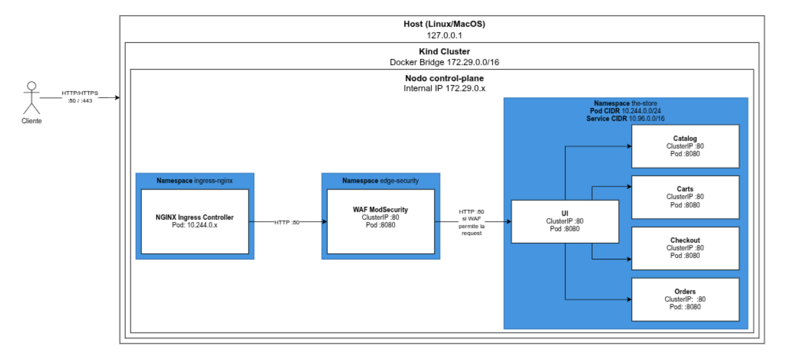

# Redes de Información - Trabajo Práctico Especial

**Instituto Tecnológico de Buenos Aires — Grupo 08**

Integrantes:
- Barnatán, Martín Alejandro (64463)
- Cantarella, Juan Ignacio (64509)
- Pedemonte Berthoud, Ignacio (64908)

Fecha de Entrega: 22/09/2026

---

## Tabla de Contenidos

1. Problemática y Contexto
2. Diseño de la Solución
3. Scope del POC y Casos de Uso
   - 3.1 Control de Acceso por Path e IP
   - 3.2 Inspección de Query Parameters
   - 3.3 Inspección del Body
   - 3.4 Inspección de Headers
   - 3.5 Validación de Estructura de la Request
4. Diagrama de Arquitectura
5. Alternativas Consideradas

---

## 1. Problemática y Contexto

The Store es una plataforma de e-commerce distribuída compuesta por una serie de microservicios y desplegada sobre un clúster de Kubernetes. El sistema se encuentra compuesto por cinco componentes principales: UI, Catalog, Cart, Checkout, Orders. Cada servicio corre en pods independientes comunicados mediante una red interna. La infraestructura cuenta con un único punto de ingreso gestionado por un Ingress Controller basado en NGINX expuesto hacia la red externa. Este punto contiene una debilidad problemática para la aplicación, ya que no cuenta con un sistema de análisis y filtrado de tráfico de Capa 7, exponiendo así una entrada para ataques maliciosos a los servicios internos.

## 2. Diseño de la Solución

Como solución a la problemática expuesta anteriormente, se propone la implementación de un Web Application Firewall (WAF) para la inspección y filtrado del tráfico HTTP/HTTPS ingresante a los servicios. El mismo se despliega como un componente independiente dentro del clúster, aportando así un desacople del Ingress Controller existente y funcionando como punto de inspección para el tráfico entre él y la aplicación. Se utiliza la imagen `owasp/modsecurity-crs:nginx`, que integra NGINX, ModSecurity v3 y el OWASP Core Rule Set (CRS).

El flujo de tráfico queda entonces definido de la siguiente manera: las solicitudes externas ingresan al clúster a través del Ingress Controller, que las redirige hacia el Service del WAF, donde son analizadas contra el ruleset definido. Las legítimas son reenviadas al Service de la UI, mientras que las maliciosas son bloqueadas por el WAF. Como capa adicional de seguridad, se generan logs estructurados de cada transacción analizada para proveer así también una posibilidad de auditoría.

## 3. Scope del POC y Casos de Uso

El alcance de la Prueba de Concepto (POC) consiste en desplegar el diseño propuesto en la sección anterior dentro del clúster local de The Store y validar su funcionamiento frente a un conjunto acotado de vulnerabilidades reales identificadas y posibles vectores de ataque en la aplicación. A continuación se detallan soluciones brindadas por el WAF para hacer frente a ellas, organizadas según la técnica de inspección empleada.

### 3.1 Control de Acceso por Path e IP

The Store expone endpoints administrativos y sensibles que no deberían ser alcanzables desde el exterior del clúster, y endpoints sin control de titularidad que permiten acceder a datos de otros usuarios (IDOR). Ambos problemas son encarados con una `allowlist` de direcciones internas sobre un conjunto de paths. Algunos casos de estas vulnerabilidades son:

1. `/utility/**` (`panic`, `stress/{iterations}`, `health/down`): acciones destructivas o de degradación del servicio.
2. `/proxy/**`, incluyendo `/proxy/orders` (datos personales de clientes) y los de IDOR `/proxy/carts/{customerId}` y `/proxy/checkout/{customerId}`.
3. `/info`, `/topology` y `/actuator/**`: exposición de atributos del pod y de topología y métricas internas.

El WAF aplica una regla personalizada que inspecciona el path y responde `403` cuando la IP de origen (tomada del header `X-Real-IP` que agrega el Ingress) no está en la `allowlist`. La regla actúa sobre el tráfico que ingresa por el Ingress; el tráfico interno entre pods no lo atraviesa, por lo que la protección cubre el perímetro de entrada. En el caso del IDOR, la `allowlist` corta el acceso directo vía `/proxy/**` pero no resuelve la falla de fondo (el flujo normal sigue sin validar titularidad). El WAF mitiga la exposición, no el IDOR en sí. Para evidenciarlo, se ejecutan los siguientes requests con y sin WAF:

```bash
curl -s -i http://localhost/proxy/orders
curl -s -i http://localhost/actuator/metrics
curl -s -i http://localhost/proxy/carts/victima-123
curl -s -i -X POST http://localhost/utility/health/down
curl -s -i http://localhost/utility/panic
```

### 3.2 Inspección de Query Parameters

En The Store, si bien no hay endpoints vulnerables a SQLi o XSS, el riesgo de inyección puede existir en dependencias de terceros, así como reintroducirse accidentalmente al incorporar nuevas features. El WAF aporta una capa de defensa en profundidad que inspecciona los parámetros de la query sobre tráfico real de la aplicación:

1. `GET /catalog?tag={value}`: el parámetro `tag` se reenvía al servicio Catalog y se incorpora a la consulta de productos. Actualmente no es explotable (Catalog parametriza la consulta), pero es un punto de entrada natural donde una regresión podría reintroducir una inyección.

El WAF inspecciona el valor de cada parámetro (`ARGS`) mediante las reglas del OWASP CRS, con las familias 942xxx (SQLi) y 941xxx (XSS). Al detectar un payload, la regla suma puntos de anomalía y, superado el umbral, el CRS bloquea la request con un código `403`. De este modo, aunque el endpoint no sea explotable, el WAF detecta y frena los patrones de ambos ataques antes de que alcancen al servicio, cubriendo el tráfico ante una eventual regresión. Para probarlo, con y sin WAF:

```bash
curl -s -i "http://localhost/catalog?tag=1'%20OR%20'1'='1"
curl -s -i "http://localhost/catalog?tag=%3Cscript%3Ealert(1)%3C/script%3E"
```

### 3.3 Inspección del Body

En The Store, algunos endpoints aceptan datos a través del cuerpo de la request y los procesan sin sanitizar, por lo que el vector de inyección no viaja en la URL sino en el `POST`. El cuerpo debe ser primero bufferizado y parseado por el WAF antes de poder analizarlo, interpretando su formato según el `Content-Type`. Esto lo convierte en un punto de inspección propio. Los casos considerados:

1. `POST /checkout`: el formulario de despacho acepta campos de texto (como `firstName` o `address1`) sin filtrar etiquetas HTML ni caracteres especiales. Es el caso de inspección de cuerpo urlencoded, que complementa el JSON del endpoint siguiente y muestra que el WAF aplica las mismas reglas sobre ambos formatos.
2. `POST /catalog/products` (agregado para el POC con vulnerabilidades controladas): endpoint de creación de productos cuyo campo `name`, enviado en el cuerpo JSON, se concatena directamente en una consulta SQL sin parametrizar y se devuelve en la respuesta sin escapar. Sin WAF, un payload `x%' OR 1=1--` altera la consulta (SQLi) y un `<script>` en `name` se ejecuta al reflejarse en la respuesta HTML (XSS reflejado).

El WAF inspecciona el cuerpo en Fase 2 (`REQUEST_BODY`, `ARGS_POST`), aplicando las mismas familias del OWASP CRS que en el caso anterior. Una vez parseado el cuerpo según su `Content-Type`, los campos quedan en `ARGS_POST` y se les aplican las mismas reglas, sin importar el formato original. Para probarlo, con y sin WAF:

```bash
curl -s -i -b "SESSIONID=11111111-1111-4111-8111-111111111111" -X POST -d "firstName=<script>alert(1)</script>&lastName=Perez&address1=Calle123&city=CABA&state=CA&zipCode=10000&email=test@itba.edu.ar" http://localhost/checkout
curl -s -i -X POST -H "Content-Type: application/json" -d '{"name": "x%'\'' OR 1=1--"}' http://localhost/catalog/products
curl -s -i -X POST -H "Content-Type: application/json" -d '{"name": "<script>alert(1)</script>"}' http://localhost/catalog/products
```

### 3.4 Inspección de Headers

En The Store, algunos requests sospechosos se detectan mediante el análisis de sus encabezados, que el WAF inspecciona en Fase 1 (`REQUEST_HEADERS`), antes de bufferizar el body. Esto habilita dos controles que no dependen del path ni del contenido, sino de quién envía la petición y cómo lo hace:

1. User-Agent de herramientas de ataque: los scanners automáticos (sqlmap, nikto, nmap, etc.) se identifican con User-Agents característicos. Bloquearlos en el borde reduce el reconocimiento automatizado, aunque es trivial de evadir cambiando el User-Agent.
2. Cookie `SESSIONID` manipulada: la sesión se identifica mediante una cookie `SESSIONID` que la aplicación acepta sin validar. Un cliente puede fijar un valor arbitrario o probar IDs predecibles y acceder al carrito o checkout de otro usuario por el flujo normal (el mismo IDOR señalado en 3.1, pero sin pasar por `/proxy`). El WAF exige que la cookie respete el formato UUID esperado, pero no protege contra el robo de uno válido.

Para el primer caso, OWASP CRS incluye la familia 913xxx, que detecta User-Agents de scanners conocidos. Con un solo match ya bloquea. Para el segundo, se define una regla personalizada que valida el formato de `REQUEST_COOKIES:SESSIONID` y responde `403` si no lo cumple. Para probarlo, con y sin WAF:

```bash
curl -s -i -A "sqlmap/1.7.2" http://localhost/
curl -s -i -b "SESSIONID=victima-123" http://localhost/cart
```

### 3.5 Validación de Estructura de la Request

El endpoint `/catalog/products` (agregado para el POC) recibe JSON. A diferencia de los casos anteriores, donde el WAF detecta patrones de ataque conocidos (modelo negativo), aquí se valida que el request respete la forma esperada (modelo positivo). Son propiedades de protocolo que reducen la superficie de ataque:

1. JSON bien formado: si el cuerpo declara `Content-Type: application/json` pero el contenido no es JSON válido (`REQBODY_ERROR`), las reglas base del motor lo rechazan con `400` antes de alcanzar el servicio.
2. Tamaño del body: la directiva `SecRequestBodyNoFilesLimit` corta los JSON o urlencoded que superan el límite configurado (`413`), mitigando abusos y DoS por payloads grandes.

Para probarlo, con y sin WAF:

```bash
curl -s -i -X POST -H "Content-Type: application/json" -d '{"name": "hola",}' http://localhost/catalog/products
python3 -c 'print("{\"name\": \"" + "a"*500000 + "\"}")' | curl -s -i -X POST -H "Content-Type: application/json" --data-binary @- http://localhost/catalog/products
```

## 4. Diagrama de Arquitectura



*Figura 1. Diagrama de Arquitectura*

## 5. Alternativas Consideradas

Como opciones analizadas de solución para la implementación del WAF, se contemplaron las otorgadas por la cátedra en la consigna: ModSecurity, Shadow Daemon y OpenWAF. La segunda opción se descartó por problemas de incompatibilidad, ya que la herramienta cuenta con soporte limitado a PHP, Python y Perl, por lo que se requeriría de la implementación de un conector. OpenWAF se descartó por problemas de confiabilidad, ya que su repositorio no registra actividad de desarrollo reciente ni una versión estable documentada. ModSecurity, en cambio, al operar exclusivamente sobre el tráfico HTTP en el borde, es agnóstico al lenguaje de cada microservicio y no exige ninguna modificación sobre el código de The Store.

Respecto al modelo de despliegue, se optó por implementar el WAF como un componente independiente y desacoplado del Ingress Controller, en lugar de utilizar el módulo ModSecurity integrado. Esto se debe a que el proyecto ingress-nginx fue discontinuado en marzo de 2026 y dejó de recibir parches de seguridad. Además, esto evita que una falla o actualización del WAF comprometa el enrutamiento general del clúster.
